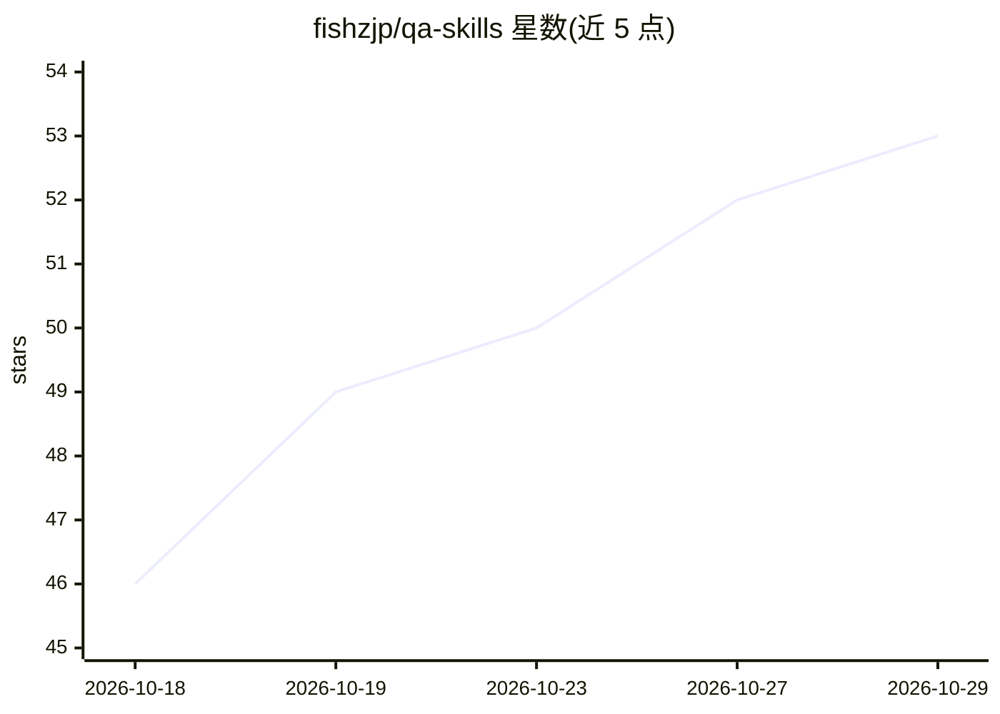

# fishzjp/qa-skills

⭐ 53 · Python · MIT · 推送 2026-10-21 · [GitHub](https://github.com/fishzjp/qa-skills) · [官网](https://fishzjp.github.io/qa-skills/) · 个人维护 · 中文 README

**面向 AI 编程 Agent 的测试工程 Skill 框架（12 skill + 共享知识库）**

以 Markdown 指令与辅助脚本形式分发的测试工程技能框架：12 个 skill（需求分析、测试策略、用例编写与审查、Playwright E2E、API/pytest 测试、探索测试、Bug 分析、回归、flaky 治理、测试记忆等）加共享知识库 core/，可跑完整流水线或单步使用，阶段产物以文件衔接、支持中断续跑。主要适配 Claude Code，对 DeepSeek Harness、Codex 等宿主有不同层次的安装实测记录。范围限于系统级黑盒测试，不含单元/移动真机/渗透测试工具链；安装 skill 不安装 Playwright、pytest、k6 等执行工具。README 附历史 On/Off 对照实验指标与口径边界说明。

## 筛选速览

| 维度 | 判定 | 备注 |
|---|---|---|
| AI 角色 | `ai-ecosystem` | LLM/agent 周边工具 |
| 许可风险 | `permissive` | MIT |
| 部署形态 | `library` | 以包/库形式分发 |
| 模型依赖 | — | README 未给出锁定关系 |
| 硬件要求 | — | 无带数字的原话,不猜 |
| 安装摩擦 | `low` | 无编译、无系统依赖或容器化 |
| 成熟度 | — | 结构信号不足 |

## 能力要点

- 12 个测试 skill 覆盖需求澄清到测试报告的完整流水线，阶段产物以文件衔接、可续跑
- 十类测试决策矩阵与 E0–E4 证据分级，记录在可校验的 type_scope
- qa-memory 在被测项目维护 .qa/ 知识库，支持跨会话经验沉淀
- 提供 skills.sh / 仓库 install.sh / 手动复制三种安装方式

## 适用场景

- 让 AI Agent 按资深测试工程师流程完整测试一个需求
- 根据 PRD/代码生成可执行测试用例并审查已有用例
- 用 Playwright/pytest 执行 Web E2E 与 API 测试并产出报告
- 治理 flaky 用例、分级回归与沉淀项目测试经验

## 场景标签

`代码生成` · 领域:编码与开发

## 证据(README 行号)

> L9:  面向 AI 编程 Agent 的测试工程 Skill 框架。 从需求澄清、风险决策，到可执行用例、自动化与测试报告。
> L17: 把测试方法、流程与产出标准装进你的 Agent：**12 个测试 skill + 一个共享知识库 `core/`**。可以跑完整流水线，也可以只写用例、审查、测接口或治理 flaky 测试。先看五组真实产出对照，了解安装前后的区别
> L142: 产品以 Markdown 指令、相对路径引用与按需运行的辅助脚本分发。宿主需要支持 skill 发现、文件读取；实际执行还需要终端或浏览器工具。

## 星数曲线

2026-10-18 46 → 2026-10-29 53（+7）

---
*卡片 v1 · prompt 1.4 · 生成 2026-10-24 · 置信度 high · 依据 README sha `63a24d2d7c25` · [字段定义](../../DATASET.md)*
