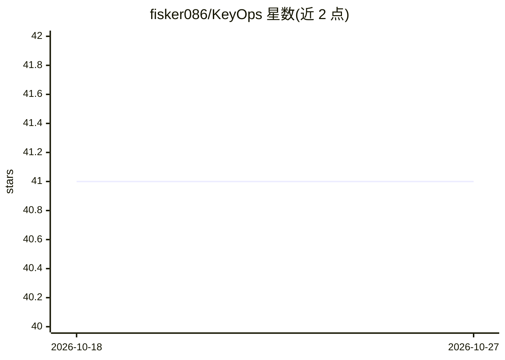

# fisker086/KeyOps

⭐ 41 · Go · MIT · 推送 2026-06-16 · [GitHub](https://github.com/fisker086/KeyOps) · 个人维护 · 中文 README

**Go 编写的企业级一体化 DevOps 运维平台（堡垒机/K8s/监控/CMDB）**

面向企业运维场景的开源一体化平台，功能覆盖 SSH/RDP 堡垒机（会话录像、命令拦截）、K8s 多集群管理、Prometheus 监控告警与 OnCall、工单审批流、多云账单 FinOps、多数据库管理与 CMDB。AI 部分为自然语言运维助手（PromQL/Grafana/K8s 工具，支持 OpenAI 兼容 LLM API）及通过 MCP 协议暴露的 CMDB/K8s/账单查询工具。部署方式为 Docker Compose，支持 MySQL 或 PostgreSQL 后端。

## 筛选速览

| 维度 | 判定 | 备注 |
|---|---|---|
| AI 角色 | `ai-enhanced` | 去掉 AI 部分产品仍成立 |
| 许可风险 | `permissive` | MIT |
| 部署形态 | `self-host` | docker 或自建部署 |
| 模型依赖 | — | README 未给出锁定关系 |
| 硬件要求 | — | 无带数字的原话,不猜 |
| 安装摩擦 | `low` | 无编译、无系统依赖或容器化 |
| 成熟度 | — | 结构信号不足 |

## 能力要点

- 堡垒机：SSH 网关、Web 终端、Guacamole RDP、会话录像与危险命令拦截
- K8s 多集群管理：工作负载、配置、部署回滚、Pod 终端与操作审计
- Prometheus 监控告警全链路：规则、策略、多渠道通知、OnCall 排班
- AI 助手 + MCP 服务：CMDB/K8s/云账单工具供 AI 调用，支持 OpenAI 兼容 API

## 适用场景

- 企业统一管理堡垒机访问权限与运维审计
- 多集群 Kubernetes 资源运维与部署管理
- 集中管理多云成本账单与告警值班
- 通过自然语言对话执行 PromQL 查询与 K8s 操作

## 场景标签

 · 领域:企业运维/DevOps 平台

## 证据(README 行号)

> L8: **Enterprise-grade DevOps platform built with Go** — bastion host, K8s multi-cluster, monitoring & alerts, DMS, clou
> L33: |**🤖 AI Assistant**|🤖 Smart Chat|Natural-language ops assistant with Prometheus/Grafana/K8s tools, multi-turn dialo
> L37: ||🧠 Multi-Model|Supports OpenAI-compatible LLM APIs, model configuration via DB|✅|

## 星数曲线

2026-10-18 41 → 2026-10-27 41（+0）

---
*卡片 v1 · prompt 1.4 · 生成 2026-10-25 · 置信度 high · 依据 README sha `f313c7e0807b` · [字段定义](../../DATASET.md)*
