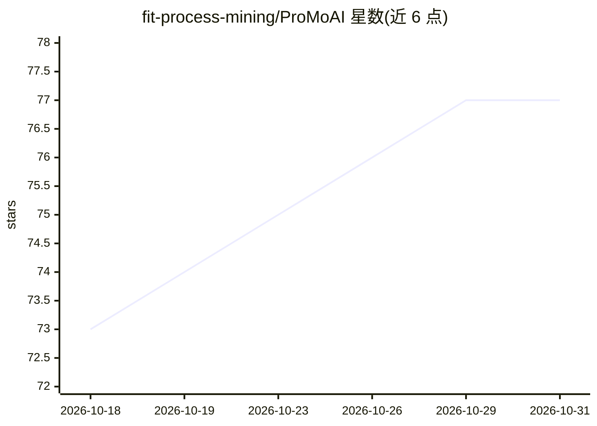

# fit-process-mining/ProMoAI

⭐ 77 · Python · AGPL-3.0 · 推送 2026-09-21 · [GitHub](https://github.com/fit-process-mining/ProMoAI) · [官网](https://promoai.streamlit.app) · 组织维护

**面向流程挖掘的 AI 套件：文本生成流程模型并自主分析事件日志**

由两模块组成的流程挖掘套件：ProMoAI 将自然语言文本或 XES 事件日志转换为 BPMN/Petri 网流程模型，并支持对话式模型精炼；PMAx 是自主多 agent 框架，通过 Engineer 与 Analyst 两类 agent 查询事件日志并生成数据支撑的报告。隐私机制上仅将列名/类型等元数据发送给 LLM，原始数据留在本地，指标由本地执行的 Python 代码计算。提供 Streamlit 云端访问、本地源码运行与 pip 安装核心组件三种方式，Python 3.9/3.10 测试通过。

## 筛选速览

| 维度 | 判定 | 备注 |
|---|---|---|
| AI 角色 | `ai-native` | 本体是模型或模型工具 |
| 许可风险 | `viral` | AGPL-3.0 |
| 部署形态 | `library` | 以包/库形式分发 |
| 模型依赖 | — | README 未给出锁定关系 |
| 硬件要求 | — | 无带数字的原话,不猜 |
| 安装摩擦 | `low` | 无编译、无系统依赖或容器化 |
| 成熟度 | — | 结构信号不足 |

## 能力要点

- 文本转 BPMN/PNML 流程模型及对话式模型精炼
- PMAx 多 agent 框架（Engineer/Analyst）从事件日志生成报告
- 仅发送元数据至 LLM，原始事件数据留在本地
- 指标由本地 Python 代码计算以规避 LLM 幻觉

## 适用场景

- 用自然语言描述生成或修改 BPMN 流程模型
- 让虚拟流程分析师查询事件日志并产出图表化报告
- 从 XES 事件日志发现初始模型再精炼

## 场景标签

`多智能体` `数据分析` · 领域:Agent 开发

## 证据(README 行号)

> L5: **ProMoAI** is an AI-powered suite for Process Mining that leverages Large Language Models (LLMs) to bridge the gap 
> L9: 1. **ProMoAI (Model Generation):** Transforms text or event logs into formal process models (BPMN/Petri nets).
> L10: 2. **PMAx (Agentic Analytics):** An autonomous multi-agent framework that functions as a virtual process analyst to

## 星数曲线

2026-10-18 73 → 2026-10-31 77（+4）

---
*卡片 v1 · prompt 1.4 · 生成 2026-10-24 · 置信度 high · 依据 README sha `a274c50c594e` · [字段定义](../../DATASET.md)*
