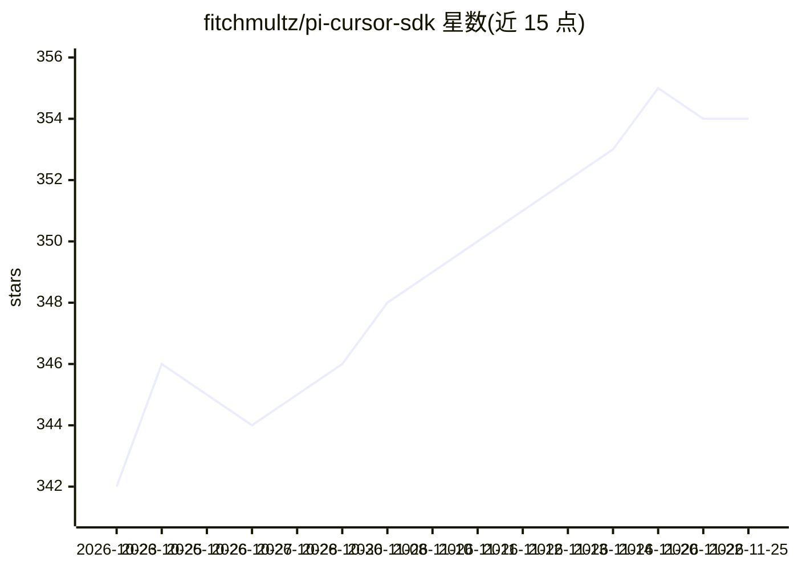

# fitchmultz/pi-cursor-sdk

⭐ 354 · TypeScript · MIT · 推送 2026-11-21 · [GitHub](https://github.com/fitchmultz/pi-cursor-sdk) · 个人维护

**让 Pi 终端 agent 通过本地 Cursor SDK 运行 Cursor 模型**

一个 pi 扩展包：在本地运行 Cursor SDK agent 并接入 Pi 会话与工具，使 Pi 用户使用 Cursor 的模型目录与控制项。提供 cursor/ 前缀模型选择、thinking 级别、fast/plan 模式切换、图像输入、会话恢复与 Cloud 可选运行时；本地 MCP 桥把 Pi 扩展工具以 pi__* 名称暴露给 Cursor agent。需要 Node.js、Pi 与 Cursor SDK API key（Dashboard 用户键或服务账号键，Team Admin 键不可用）；本地运行默认关闭 Cursor 自动审查与沙箱。

## 筛选速览

| 维度 | 判定 | 备注 |
|---|---|---|
| AI 角色 | `ai-ecosystem` | LLM/agent 周边工具 |
| 许可风险 | `permissive` | MIT |
| 部署形态 | `None` |  |
| 模型依赖 | — | README 未给出锁定关系 |
| 硬件要求 | — | 无带数字的原话,不猜 |
| 安装摩擦 | `low` | 无编译、无系统依赖或容器化 |
| 成熟度 | — | 结构信号不足 |

## 能力要点

- 通过 cursor/ 前缀在 Pi 中选择 Cursor 模型，支持 @1m 上下文窗口与 :fast/:slow 选择
- 本地 MCP 桥将活跃的 Pi 扩展工具暴露为 pi__* 名称
- 支持 /cursor-usage 读取与导出 Cursor 计费数据
- 可选 /cursor-runtime cloud 运行时，本地为默认

## 适用场景

- 在 Pi 终端界面里使用 Cursor 的模型与 agent 能力
- 在 Pi 会话中复用 Pi 扩展工具驱动 Cursor agent
- 需要按模型查看和导出 Cursor 用量与计费数据

## 场景标签

`编码 Agent` `模型网关` · 领域:Agent 开发

## 证据(README 行号)

> L3: Use Cursor models in Pi's terminal UI. `pi-cursor-sdk` runs Cursor's SDK agent and connects it to Pi sessions and ex
> L5: Pi connects to a local Cursor SDK agent through pi-cursor-sdk. The agent uses Cursor tools and a bridge to Pi tools.

## 星数曲线

2026-10-23 342 → 2026-11-25 354（+12）

---
*卡片 v1 · prompt 1.4 · 生成 2026-11-25 · 置信度 high · 依据 README sha `5c440a25961a` · [字段定义](../../DATASET.md)*
