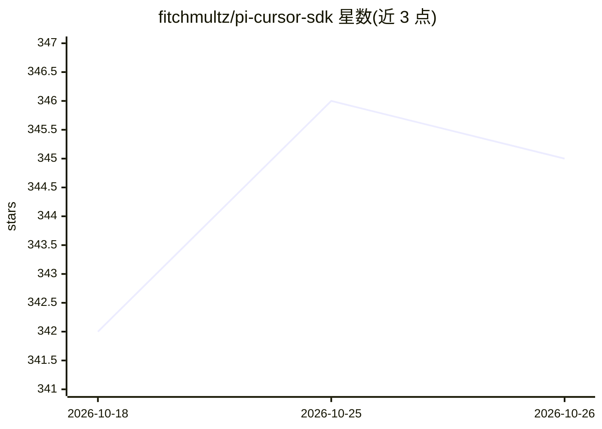

# fitchmultz/pi-cursor-sdk

⭐ 345 · TypeScript · MIT · 推送 2026-10-25 · [GitHub](https://github.com/fitchmultz/pi-cursor-sdk) · 个人维护

**在 Pi 终端编码代理中接入 Cursor SDK 模型的提供方扩展**

pi coding agent 的 provider 扩展包：在本地运行 Cursor 的 SDK agent，将 Cursor 模型接入 Pi 会话，支持模型选择、thinking 级别、fast/plan 模式、图片输入与上下文窗口指定（@1m）。通过 MCP 桥接把 Pi 扩展工具以 pi__* 名称暴露给 Cursor agent，可复用/重连本地 agent 会话，并提供 /cursor-usage 计费数据查询。需 Node.js 24+、Pi 0.87.1+ 与 Cursor SDK API key；本地运行时 Cursor 的自动审查与沙箱默认关闭，另有可选 Cursor Cloud 运行时（Max Mode 计费）。

## 筛选速览

| 维度 | 判定 | 备注 |
|---|---|---|
| AI 角色 | `ai-ecosystem` | LLM/agent 周边工具 |
| 许可风险 | `permissive` | MIT |
| 部署形态 | `None` |  |
| 模型依赖 | — | README 未给出锁定关系 |
| 硬件要求 | — | 无带数字的原话,不猜 |
| 安装摩擦 | `low` | 无编译、无系统依赖或容器化 |
| 成熟度 | — | 结构信号不足 |

## 能力要点

- cursor/ 前缀模型选择，支持 @1m 上下文与 :fast/:slow 变体
- MCP 桥接将 Pi 扩展工具以 pi__* 名称暴露给 Cursor agent
- 会话复用与重启后重连（失败时从 Pi transcript 新建 agent）
- /cursor-usage 查询与导出 Cursor 计费数据

## 适用场景

- 在 Pi 终端 UI 中直接使用 Cursor 模型与工具
- 在 Pi 工作流里切换 Cursor fast/plan 模式与 thinking 级别
- 查看并导出 Cursor 用量计费数据

## 场景标签

`编码 Agent` · 领域:编码与开发

## 证据(README 行号)

> L3: Use Cursor models in Pi's terminal UI. `pi-cursor-sdk` runs Cursor's SDK agent and connects it to Pi sessions and ex
> L5: Pi connects to a local Cursor SDK agent through pi-cursor-sdk. The agent uses Cursor tools and a bridge to Pi tools.
> L16: pi install npm:pi-cursor-sdk

## 星数曲线

2026-10-18 342 → 2026-10-26 345（+3）

---
*卡片 v1 · prompt 1.4 · 生成 2026-10-21 · 置信度 high · 依据 README sha `9221d91fb2d6` · [字段定义](../../DATASET.md)*
