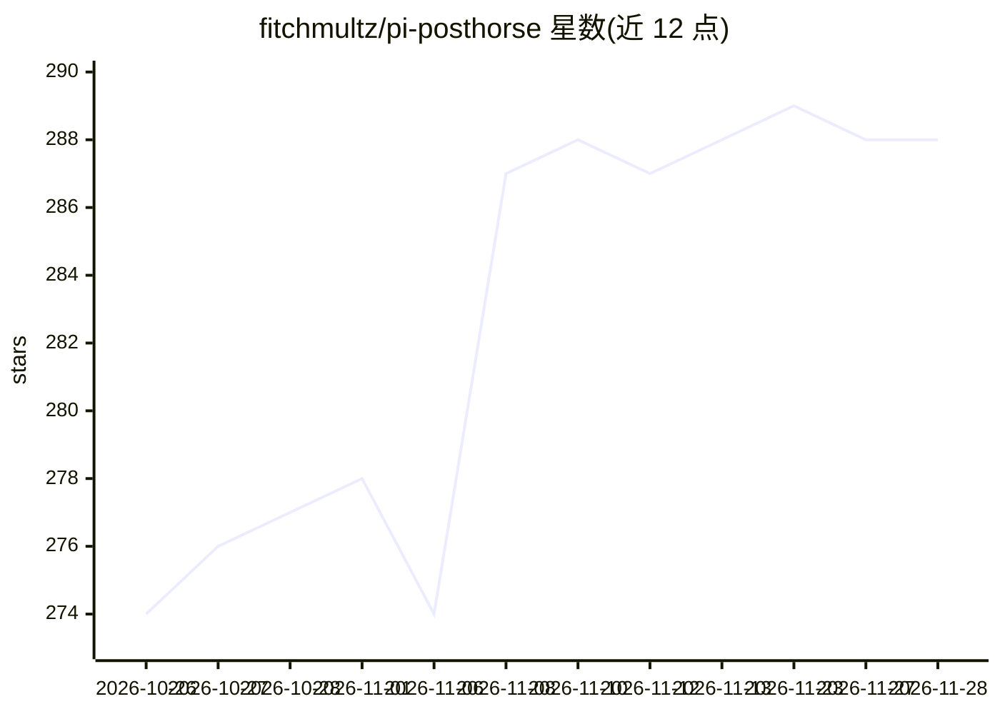

# fitchmultz/pi-posthorse

⭐ 288 · TypeScript · MIT · 推送 2026-11-27 · [GitHub](https://github.com/fitchmultz/pi-posthorse) · 个人维护

**Pi 编码代理的上下文滚动扩展：无摘要换新窗口**

为 Pi 编码代理提供不依赖模型自动摘要的上下文滚动机制：会话滚入新上下文窗口时保留任务笔记与完整会话记录，附带恢复记录替代摘要，模型须先恢复笔记再继续工作。提供 new_context、get_context_remaining、notes、history 四个工具，复用 Pi 的 compaction 配置，支持官方 Pi 1.0+ 与 fitchmultz/pi fork。通过 npm 包经 pi install 安装，无网络请求，笔记以明文存储在 .pi/notes/。

## 筛选速览

| 维度 | 判定 | 备注 |
|---|---|---|
| AI 角色 | `ai-ecosystem` | LLM/agent 周边工具 |
| 许可风险 | `permissive` | MIT |
| 部署形态 | `None` |  |
| 模型依赖 | — | README 未给出锁定关系 |
| 硬件要求 | — | 无带数字的原话,不猜 |
| 安装摩擦 | `low` | 无编译、无系统依赖或容器化 |
| 成熟度 | — | 结构信号不足 |

## 能力要点

- 无模型摘要的上下文滚动，保留消息尾段与有界恢复记录
- notes/history 工具支持笔记读写检索与历史会话搜索（含图片）
- new_context 工具可请求无保留消息的干净重置
- 无网络请求，笔记为本地明文文件

## 适用场景

- 长时间编码任务中避免自动摘要导致的信息丢失
- 跨多个上下文窗口维持任务状态
- 检索早前会话内容（含子代理运行）

## 场景标签

`编码 Agent` · 领域:编码与开发

## 证据(README 行号)

> L3: Posthorse starts fresh context windows for long Pi tasks without an automatic model-generated summary of the work. O
> L9: Check the Node.js and Pi requirements before installing. Posthorse supports official Pi and fitchmultz/pi.

## 星数曲线

2026-10-26 274 → 2026-11-28 288（+14）

---
*卡片 v1 · prompt 1.4 · 生成 2026-11-25 · 置信度 high · 依据 README sha `ad7cc7aba7f3` · [字段定义](../../DATASET.md)*
