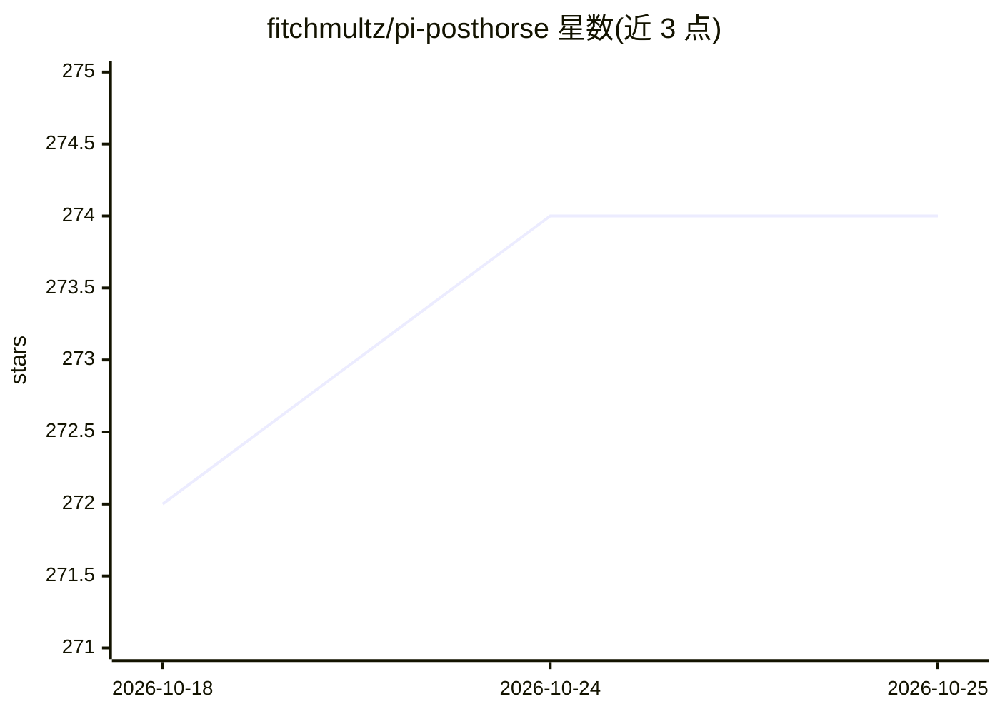

# fitchmultz/pi-posthorse

⭐ 274 · TypeScript · MIT · 推送 2026-10-24 · [GitHub](https://github.com/fitchmultz/pi-posthorse) · 个人维护

**Pi 编码代理的无摘要上下文轮转扩展，附持久笔记**

面向 Pi coding agent（官方 Pi 1.0+ 或 fitchmultz/pi fork）的扩展包：在长任务上下文耗尽时开启新的上下文窗口，不调用摘要模型，而是保留近期消息尾部（keepRecentTokens）与有界恢复记录，并提供 new_context、上下文余量估算、notes 与 history 四个工具供模型保存/检索任务笔记和历史会话。需 Node 24.12.0+ 与 Pi 1.3.0+，通过 pi install npm:pi-posthorse 安装；不发起网络请求，笔记以明文存储于 .pi/notes/。限制：不保证模型可完整回忆历史，超大输入可能先到达 provider。

## 筛选速览

| 维度 | 判定 | 备注 |
|---|---|---|
| AI 角色 | `ai-ecosystem` | LLM/agent 周边工具 |
| 许可风险 | `permissive` | MIT |
| 部署形态 | `None` |  |
| 模型依赖 | — | README 未给出锁定关系 |
| 硬件要求 | — | 无带数字的原话,不猜 |
| 安装摩擦 | `low` | 无编译、无系统依赖或容器化 |
| 成熟度 | — | 结构信号不足 |

## 能力要点

- 自动轮转不调用摘要模型，保留近期尾部与有界恢复记录
- 提供 new_context/get_context_remaining/notes/history 四个工具
- 笔记与完整会话记录跨上下文窗口持久可用
- 无网络请求，笔记为明文本地文件

## 适用场景

- 长任务中让编码代理保留任务状态并继续工作
- 避免摘要模型造成的信息损失，改用笔记+历史检索
- 跨会话与子代理运行中检索早期对话与工具证据

## 场景标签

`Agent 记忆` · 领域:Agent 开发

## 证据(README 行号)

> L3: Posthorse starts fresh context windows for long Pi tasks without an automatic model-generated summary. Stock Pi alre
> L36: These tools are available to the model:

## 星数曲线

2026-10-18 272 → 2026-10-25 274（+2）

---
*卡片 v1 · prompt 1.4 · 生成 2026-10-22 · 置信度 high · 依据 README sha `b44b1b4c0dfc` · [字段定义](../../DATASET.md)*
