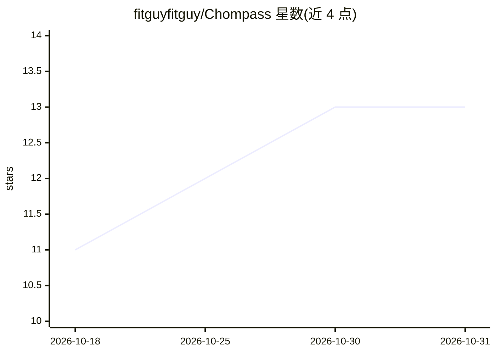

# fitguyfitguy/Chompass

⭐ 13 · Kotlin · NOASSERTION · 推送 2026-10-29 · [GitHub](https://github.com/fitguyfitguy/Chompass) · [官网](https://chompass.app/) · 个人维护

**带 AI 食物识别的私有热量追踪应用（PWA/Android）**

面向个人用户的热量与营养记录应用，提供 Android 应用与浏览器 PWA 两种形态。记录方式包括拍照（最多 10 张）、语音、条码（Open Food Facts，460 万+产品离线缓存）与手动输入；AI 部分由用户自带云端 key 或在 Android 上选装端侧 Gemma 4 模型，Coach 对话需云端提供方。支持体重、体脂等趋势记录与 Health Connect 双向同步、WebDAV 自托管同步、JSON/CSV 导出导入。基于 Fud AI 修改，GPL-3.0，通过 F-Droid/Obtainium/Codeberg 分发，无广告、无统计、无账号。

## 筛选速览

| 维度 | 判定 | 备注 |
|---|---|---|
| AI 角色 | `ai-native` | 本体是模型或模型工具 |
| 许可风险 | `none` | NOASSERTION |
| 部署形态 | `None` |  |
| 模型依赖 | — | README 未给出锁定关系 |
| 硬件要求 | — | 无带数字的原话,不猜 |
| 安装摩擦 | `low` | 无编译、无系统依赖或容器化 |
| 成熟度 | — | 结构信号不足 |

## 能力要点

- 拍照/语音/条码/文字多方式记录食物摄入
- 自带 API key 的云端 AI 或 Android 端侧 Gemma 4 推理
- Health Connect 双向同步（步数、睡眠、心率等）与 WebDAV 自托管同步
- PWA 与 Android 共享同一 JSON 数据格式，本地优先、无广告无账号

## 适用场景

- 记录每餐饮食并追踪热量与宏量营养素
- 用手机拍照或语音让 AI 估算食物热量
- 端侧运行 AI 保证饮食照片不离开手机
- 与体重秤/手环等 Health Connect 应用同步体重与活动数据

## 场景标签

`图像视频处理` · 领域:感知与多模态

## 证据(README 行号)

> L7: Bring your own AI key. On Android you can also run Gemma 4 on-device. No ads, no analytics, no account.
> L85: - **AI**: your own cloud key (a free Google AI Studio key is enough for casual use). Progress steps and a live fiel

## 星数曲线

2026-10-18 11 → 2026-10-31 13（+2）

---
*卡片 v1 · prompt 1.4 · 生成 2026-10-31 · 置信度 high · 依据 README sha `29bdb7dce880` · [字段定义](../../DATASET.md)*
