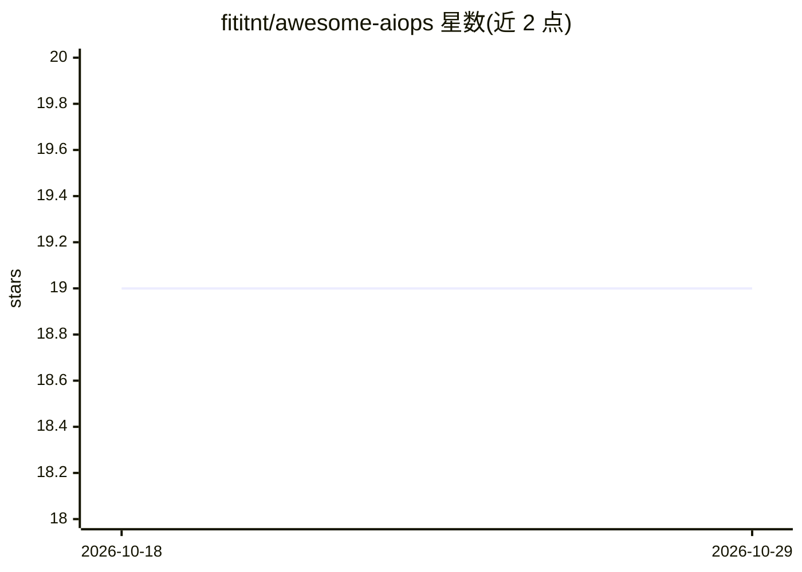

# fititnt/awesome-aiops

⭐ 19 · Unlicense · 推送 2026-05-10 · [GitHub](https://github.com/fititnt/awesome-aiops) · 个人维护

**AIOps 文章与工具的策展清单（草稿）**

一份标注为 Draft 的 Awesome 类型清单，收录 AIOps 相关的文章条目与工具条目（如 KubeStellar Console 多集群 Kubernetes 仪表盘），并链接多个相关 Awesome 清单（AI、Bots、ChatOps、神经科学）。仓库本身不提供软件功能，仅做条目聚合与分类，采用 CC0 许可。目前条目数量较少，处于早期整理状态。

## 筛选速览

| 维度 | 判定 | 备注 |
|---|---|---|
| AI 角色 | `ai-knowledge` | 知识聚合/清单类 |
| 许可风险 | `permissive` | Unlicense |
| 部署形态 | `None` |  |
| 模型依赖 | — | README 未给出锁定关系 |
| 硬件要求 | — | 无带数字的原话,不猜 |
| 安装摩擦 | `low` | 无编译、无系统依赖或容器化 |
| 成熟度 | `idea` | |

## 能力要点

- 收录 AIOps 相关文章条目
- 收录 AIOps 工具条目（如 KubeStellar Console）
- 链接多个相关 Awesome 清单

## 适用场景

- 查找 AIOps 概念介绍文章
- 发现 AIOps 相关开源工具与相邻领域清单

## 场景标签

`精选清单` · 领域:学习与行业

## 证据(README 行号)

> L3: ## Articles
> L7: ## Tools

## 星数曲线

2026-10-18 19 → 2026-10-29 19（+0）

---
*卡片 v1 · prompt 1.4 · 生成 2026-10-28 · 置信度 high · 依据 README sha `c2671a1e95fc` · [字段定义](../../DATASET.md)*
