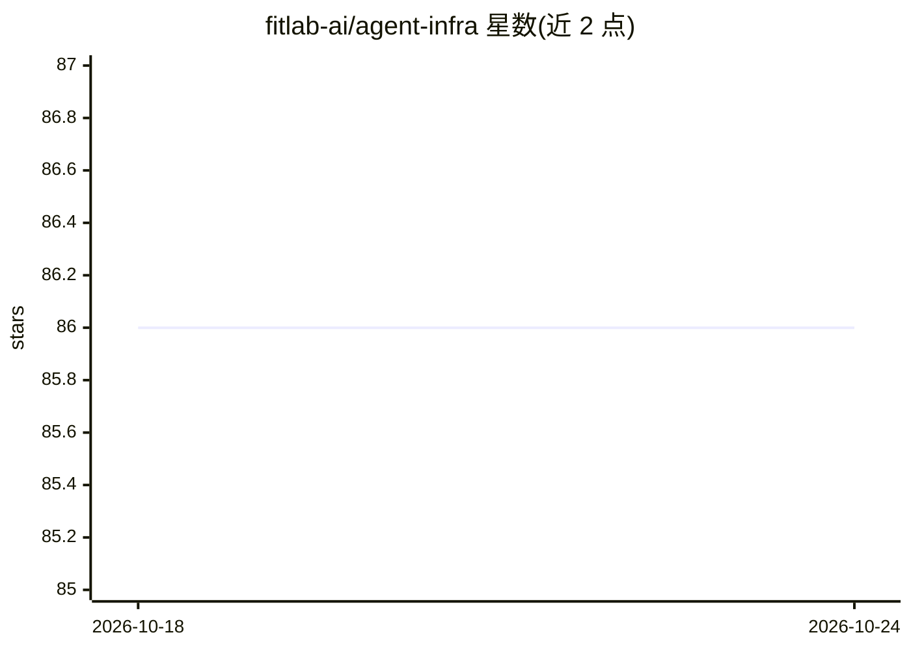

# fitlab-ai/agent-infra

⭐ 86 · TypeScript · MIT · 推送 2026-10-24 · [GitHub](https://github.com/fitlab-ai/agent-infra) · 组织维护 · 中文 README

**给 AI 编程代理团队的协作基础设施：统一技能、工作流与沙箱**

面向在同一仓库混用多种 AI 编程 CLI 的团队，为 Claude Code、Codex、Antigravity CLI、OpenCode、TraeCode CLI 提供统一的共享层：相同的任务生命周期（分析→计划→编码→独立代码评审→PR）、技能词汇表、项目治理文件与隔离开发沙箱。通过 npm/Shell 脚本/Homebrew 安装 CLI，`ai init` 初始化项目后在 AI TUI 内渲染模板并同步技能。任务按风险选择精简/标准/完整路径，附带飞书命令桥、双语文档与可审计的追加式流程数据归档。限制：依赖 Node.js 环境，Codex 的 run-task 编排通道处于实验状态。

## 筛选速览

| 维度 | 判定 | 备注 |
|---|---|---|
| AI 角色 | `ai-ecosystem` | LLM/agent 周边工具 |
| 许可风险 | `permissive` | MIT |
| 部署形态 | `library` | 以包/库形式分发 |
| 模型依赖 | — | README 未给出锁定关系 |
| 硬件要求 | — | 无带数字的原话,不猜 |
| 安装摩擦 | `low` | 无编译、无系统依赖或容器化 |
| 成熟度 | — | 结构信号不足 |

## 能力要点

- 一套操作模型覆盖 5 种 AI 编程客户端，任务中途可切换工具
- 风险选择的三级任务生命周期，每条路径都含独立代码评审
- 任务级沙箱经 broker 校验请求/清单/租约后启动单请求执行器
- 飞书消息桥接内置命令与只读任务视图

## 适用场景

- 团队统一多个 AI 编程 CLI 的工作流与治理文件
- 从 GitHub Issue 到合并 PR 的全流程任务管理
- 用隔离沙箱执行 AI 生成的代码变更

## 场景标签

`多智能体` `代码审查` · 领域:Agent 开发

## 证据(README 行号)

> L5:  Collaboration infrastructure for AI coding agents — skills, workflows, and sandboxes for Claude Code, Codex, Antigr
> L23: agent-infra standardizes that shared infrastructure. It gives every supported AI TUI the same task lifecycle, the s
> L84: - **Multi-AI collaboration**: one shared operating model for Claude Code, Codex, Antigravity CLI, and OpenCode

## 星数曲线

2026-10-18 86 → 2026-10-24 86（+0）

---
*卡片 v1 · prompt 1.4 · 生成 2026-10-24 · 置信度 high · 依据 README sha `abfb85e2bbdf` · [字段定义](../../DATASET.md)*
