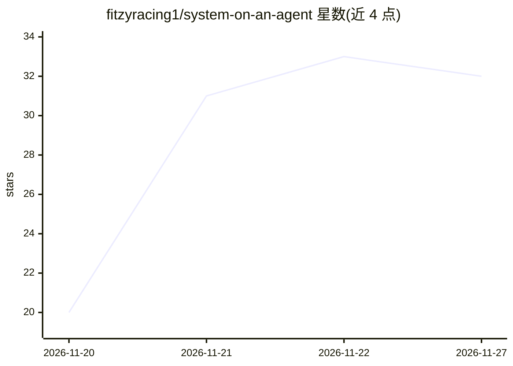

# fitzyracing1/system-on-an-agent

⭐ 32 · Python · MIT · 推送 2026-11-19 · [GitHub](https://github.com/fitzyracing1/system-on-an-agent) · [官网](https://fitzyracing1.github.io/system-on-an-agent/) · 个人维护

**给开发者的极简 agent 框架：规划器、记忆、技能、连接器与总线合一**

一个 Python 实现的 agent 框架，将规划器、记忆与技能、连接器、总线四部分组成单一 agent，类比片上系统架构。默认规划器为确定性规则驱动，无需语言模型，可选接入 LLMProvider 接口，模型输出无效计划时回退到规则规划器。记忆支持 JSON 持久化，插件通过 manifest 与钩子接口加载，提供 soa CLI 运行与 JSON 报告输出。

## 筛选速览

| 维度 | 判定 | 备注 |
|---|---|---|
| AI 角色 | `ai-ecosystem` | LLM/agent 周边工具 |
| 许可风险 | `permissive` | MIT |
| 部署形态 | `library` | 以包/库形式分发 |
| 模型依赖 | — | README 未给出锁定关系 |
| 硬件要求 | — | 无带数字的原话,不猜 |
| 安装摩擦 | `low` | 无编译、无系统依赖或容器化 |
| 成熟度 | — | 结构信号不足 |

## 能力要点

- 确定性规则规划器为默认，LLM 为可选接口并有回退机制
- 工作记忆与长期记忆分离，事实可持久化为 JSON
- 插件通过 manifest 与 5 类钩子接入，无需修改核心
- 内置文件连接器与 echo 连接器，soa CLI 支持 --json 机器可读输出

## 适用场景

- 构建不依赖 LLM 的确定性 agent 流程
- 以钩子机制扩展 agent 的执行步骤
- 本地记忆存储与事实检索的原型开发

## 场景标签

`Agent 框架` · 领域:Agent 开发

## 证据(README 行号)

> L23: - **Planner.** Takes a goal, builds a plan, and runs it step by step. The default planner is deterministic and rule
> L30: Requires Python 3.10 or newer.

## 星数曲线

2026-11-20 20 → 2026-11-27 32（+12）

---
*卡片 v1 · prompt 1.4 · 生成 2026-11-20 · 置信度 high · 依据 README sha `5ded5edea948` · [字段定义](../../DATASET.md)*
