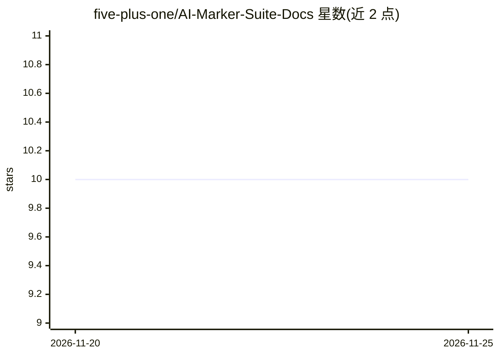

# five-plus-one/AI-Marker-Suite-Docs

⭐ — · [GitHub]() · 个人维护 · 中文 README

**AI 批改助手的文档站：查找脚本安装、评分设置与平台阅卷步骤**

该仓库是 AI 批改助手（AI-Marker-Suite）的使用文档站源码，内容覆盖脚本安装、评分设置、各平台阅卷入口、适用任务与给分方式。站点由 VitePress 构建，配套本地开发约定（Node.js/npm 固定版本）、内部 Forgejo CI 构建部署流程、构建时生成搜索索引、SEO 元数据、llms.txt 等发现文件，并提供链接与锚点检查脚本。面向需要安装和使用该批改脚本的用户，以及维护该文档的贡献者。

## 筛选速览

| 维度 | 判定 | 备注 |
|---|---|---|
| AI 角色 | `ai-knowledge` | 知识聚合/清单类 |
| 许可风险 | `none` | — |
| 部署形态 | `library` | 以包/库形式分发 |
| 模型依赖 | — | README 未给出锁定关系 |
| 硬件要求 | — | 无带数字的原话,不猜 |
| 安装摩擦 | `low` | 无编译、无系统依赖或容器化 |
| 成熟度 | — | 结构信号不足 |

## 能力要点

- 平台目录按名称提供阅卷入口、适用任务、给分方式和安装要求
- VitePress 构建，含章节搜索、键盘跳转与手机导航样式
- 构建时生成 llms.txt / llms-full.txt 等 AI 可读文档目录
- npm run check 检查 62 个历史路径与 746 个章节锚点及 SEO 元数据

## 适用场景

- 查找某个阅卷平台的脚本安装与配置步骤
- 了解各平台支持的批改任务和给分方式
- 为文档站做本地开发、构建与部署

## 场景标签

`教程课程` · 领域:学习与行业

## 证据(README 行号)

> L3: AI 批改助手文档提供脚本安装、评分设置和平台使用步骤。平台目录可按名称查找阅卷入口、适用任务、给分方式和安装要求。使用文档 · 平台目录 · 脚本源码
> L7: 站点由 VitePress 构建，搜索、阅读操作和即时提示使用 `@fiveplusone/ui`。本地开发约定使用 Node.js 22 和 npm 10，`packageManager` 固定为 `npm@10.9.9`。正式 

## 星数曲线

2026-11-20 10 → 2026-11-25 10（+0）

---
*卡片 v1 · prompt 1.4 · 生成 2026-11-20 · 置信度 high · 依据 README sha `3d6b222d9b57` · [字段定义](../../DATASET.md)*
