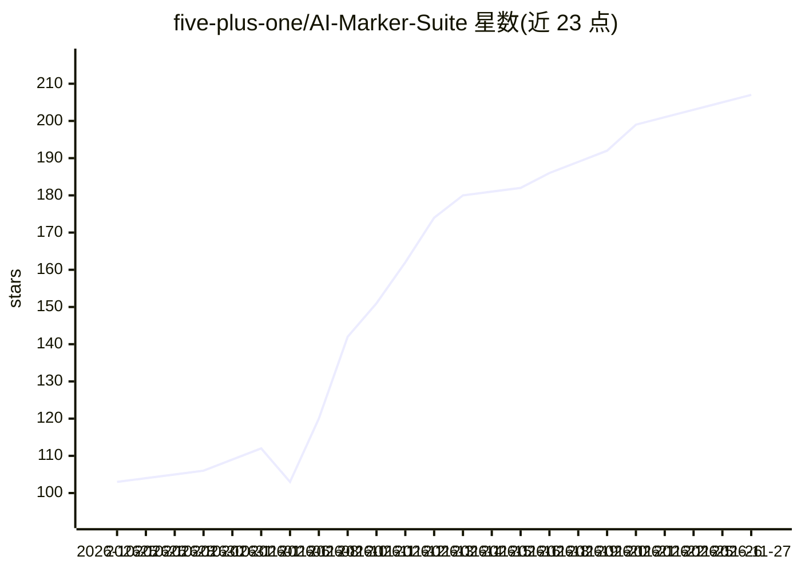

# five-plus-one/AI-Marker-Suite

⭐ 207 · JavaScript · GPL-3.0 · 推送 2026-11-26 · [GitHub](https://github.com/five-plus-one/AI-Marker-Suite) · [官网](https://aimarking.five-plus-one.com/) · 个人维护 · 中文 README

**面向教师的浏览器阅卷脚本，按评分标准识别手写作答并建议得分**

以 Tampermonkey 用户脚本形式分发的开源浏览器工具，嵌入智学网、好分数等数十个在线阅卷平台页面：教师填写参考答案与评分标准后，脚本读取答卷图片，由 AI 模型识别手写作答、生成得分建议与评语，并自动填入原站分数框。提供试改确认、无人值守、双模型评分加第三模型仲裁、分小题打分、分数纠错与评阅历史导出（HTML/CSV/JSON/ZIP）等机制。模型调用需自配 API 密钥，按服务商计费；仅支持电脑端浏览器。

## 筛选速览

| 维度 | 判定 | 备注 |
|---|---|---|
| AI 角色 | `ai-native` | 本体是模型或模型工具 |
| 许可风险 | `viral` | GPL-3.0 |
| 部署形态 | `None` |  |
| 模型依赖 | — | README 未给出锁定关系 |
| 硬件要求 | — | 无带数字的原话,不猜 |
| 安装摩擦 | `low` | 无编译、无系统依赖或容器化 |
| 成熟度 | — | 结构信号不足 |

## 能力要点

- 识别手写作答并按教师设定的评分标准生成得分、评语与得分理由
- 双模型独立评分、分差超阈值触发第三模型仲裁的双评工作流
- 适配智学网、好分数等数十个在线阅卷平台，支持分小题评分
- 评阅历史可导出 HTML 报告、CSV、JSON 与含答题卡图片的材料包 ZIP

## 适用场景

- 日常批改作文、解答题、论述题等主观题答卷
- 大考统考场景用双评仲裁提高给分一致性
- 夜间挂机批量批改大量试卷
- 导出评阅记录做复核或生成本地改卷总结

## 场景标签

`OCR` · 领域:感知与多模态

## 证据(README 行号)

> L3: AI 批改助手是面向教师的开源浏览器脚本。在支持的网页阅卷任务中，按参考答案和评分标准识别手写作答、建议得分并填写原站分数。支持试改确认、分小题评分、双评仲裁和评阅历史导出。
> L59: - AI 自动识别手写答案，根据你设定的评分标准打分
> L106: ### 多服务商

## 星数曲线

2026-10-25 103 → 2026-11-27 207（+104）

---
*卡片 v1 · prompt 1.4 · 生成 2026-11-27 · 置信度 high · 依据 README sha `6d0f0487aa61` · [字段定义](../../DATASET.md)*
