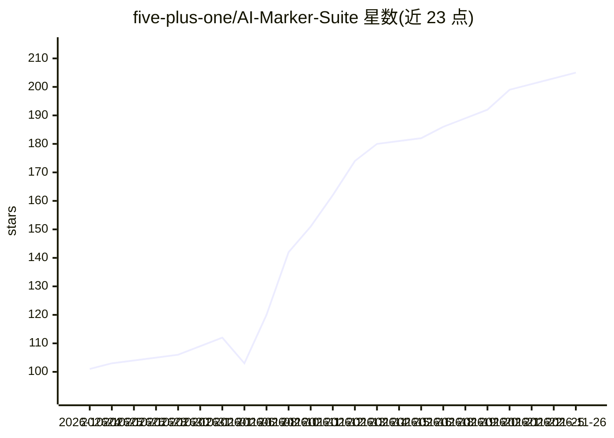

# five-plus-one/AI-Marker-Suite

⭐ 205 · JavaScript · GPL-3.0 · 推送 2026-11-25 · [GitHub](https://github.com/five-plus-one/AI-Marker-Suite) · [官网](https://aimarking.five-plus-one.com/) · 个人维护 · 中文 README

**给教师的浏览器阅卷脚本：识别手写作答并按评分标准给分**

以 Tampermonkey 用户脚本形式安装，注入智学网、好分数等 40+ 国内网上阅卷平台页面；读取答卷图片，调用视觉模型识别手写作答、按教师填写的参考答案与评分标准建议分数并填入原站输入框。提供试改确认、普通、无人值守、双评仲裁四种模式，支持分小题评分、分数纠错、评阅历史导出（HTML/CSV/JSON/ZIP）。模型调用按所选 API 服务计费，脚本本身免费开源（GPL-3.0）；仅支持桌面端 Chrome/Edge/Firefox。

## 筛选速览

| 维度 | 判定 | 备注 |
|---|---|---|
| AI 角色 | `ai-native` | 本体是模型或模型工具 |
| 许可风险 | `viral` | GPL-3.0 |
| 部署形态 | `None` |  |
| 模型依赖 | — | README 未给出锁定关系 |
| 硬件要求 | — | 无带数字的原话,不猜 |
| 安装摩擦 | `low` | 无编译、无系统依赖或容器化 |
| 成熟度 | — | 结构信号不足 |

## 能力要点

- 在 40+ 国内阅卷平台页面注入浮动工具，识别手写作答并自动填分
- 双评模式：两模型独立评分，分差超阈值触发第三模型逐小题仲裁
- 分数纠错：输入正确分数后自动分析原因并优化评分标准
- 评阅历史支持导出 HTML/CSV/JSON 及含答题卡图片的材料包 ZIP

## 适用场景

- 在智学网、好分数等平台批改作文、解答题等主观题
- 统考等高精度场景用双评仲裁模式减少给分分歧
- 夜间挂机无人值守批量阅卷并设置份数上限
- 导出批改记录和材料包做阅卷复盘总结

## 场景标签

`OCR` · 领域:感知与多模态

## 证据(README 行号)

> L3: AI 批改助手是面向教师的开源浏览器脚本。在支持的网页阅卷任务中，按参考答案和评分标准识别手写作答、建议得分并填写原站分数。支持试改确认、分小题评分、双评仲裁和评阅历史导出。
> L59: - AI 自动识别手写答案，根据你设定的评分标准打分
> L107: - 内置 5+1 AI 推荐服务（免费注册）
> L142: 暂不支持。需在**电脑端**浏览器（Chrome / Edge / Firefox）+ Tampermonkey 使用。

## 星数曲线

2026-10-24 101 → 2026-11-26 205（+104）

---
*卡片 v1 · prompt 1.4 · 生成 2026-11-25 · 置信度 high · 依据 README sha `bc81c3d5ed57` · [字段定义](../../DATASET.md)*
