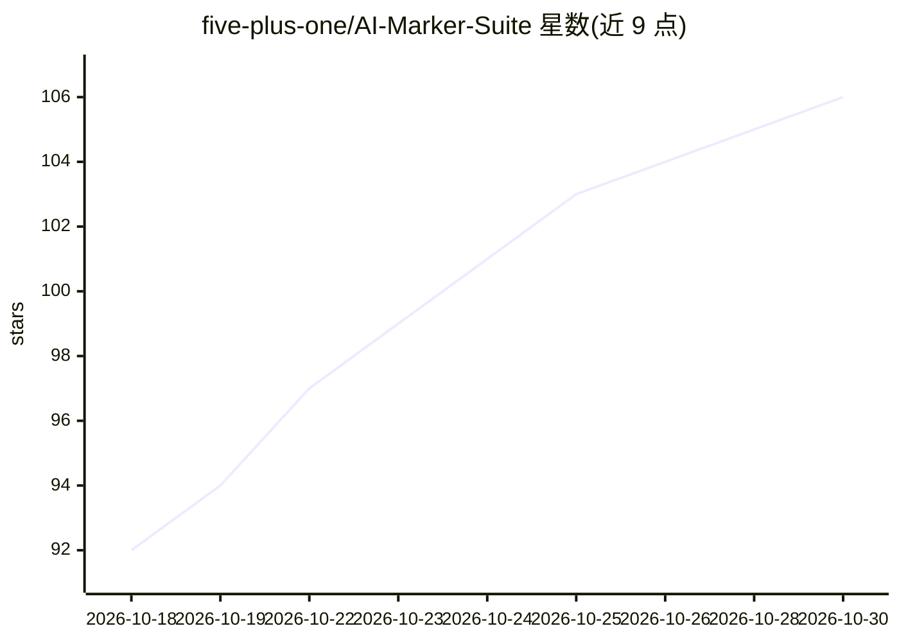

# five-plus-one/AI-Marker-Suite

⭐ 106 · JavaScript · GPL-3.0 · 推送 2026-10-29 · [GitHub](https://github.com/five-plus-one/AI-Marker-Suite) · [官网](https://aimarking.five-plus-one.com/) · 个人维护 · 中文 README

**给教师的多平台 AI 阅卷油猴脚本：自动识别手写答案并打分填分**

运行在浏览器 Tampermonkey 中的用户脚本，适配智学网、七天网络、好分数等 30 个国内阅卷平台。对主观题手写答案，调用 OpenAI 兼容接口的 LLM（内置 5+1 AI 服务，也支持 DeepSeek、火山引擎、硅基流动等）按教师设定的评分标准评分，自动填分并提交。提供普通/试改/无人值守/双评仲裁四种模式、分小题评分、分数纠错、评阅历史导出（HTML/CSV/JSON/材料包ZIP）。仅支持电脑端浏览器，脚本免费开源但模型调用按 tokens 计费，免责声明要求教师审核确认 AI 评分结果。

## 筛选速览

| 维度 | 判定 | 备注 |
|---|---|---|
| AI 角色 | `ai-native` | 本体是模型或模型工具 |
| 许可风险 | `viral` | GPL-3.0 |
| 部署形态 | `None` |  |
| 模型依赖 | locked-api |  |
| 硬件要求 | — | 无带数字的原话,不猜 |
| 安装摩擦 | `low` | 无编译、无系统依赖或容器化 |
| 成熟度 | — | 结构信号不足 |

## 能力要点

- 适配 30 个阅卷平台，自动识别→打分→填分→提交→下一份
- 双模型独立评分 + 分差超阈值触发第三模型仲裁
- 四种批改模式（普通/试改/无人值守/双评）与分小题评分
- 评阅历史导出 HTML/CSV/JSON/材料包ZIP，配置 JSON 备份恢复

## 适用场景

- 晚间无人值守批量批改主观题试卷
- 大考统考场景用双评仲裁模式提高评分一致性
- 批改后导出评阅历史与材料包供回评和总结

## 场景标签

 · 领域:教育/自动批改

## 证据(README 行号)

> L17: |每道题都要手动输分、点提交|**全自动**：识别 → 打分 → 填入 → 提交 → 下一份|
> L63: - AI 自动识别手写答案，根据你设定的评分标准打分

## 星数曲线

2026-10-18 92 → 2026-10-30 106（+14）

---
*卡片 v1 · prompt 1.4 · 生成 2026-10-23 · 置信度 high · 依据 README sha `fb7ae90597cb` · [字段定义](../../DATASET.md)*
