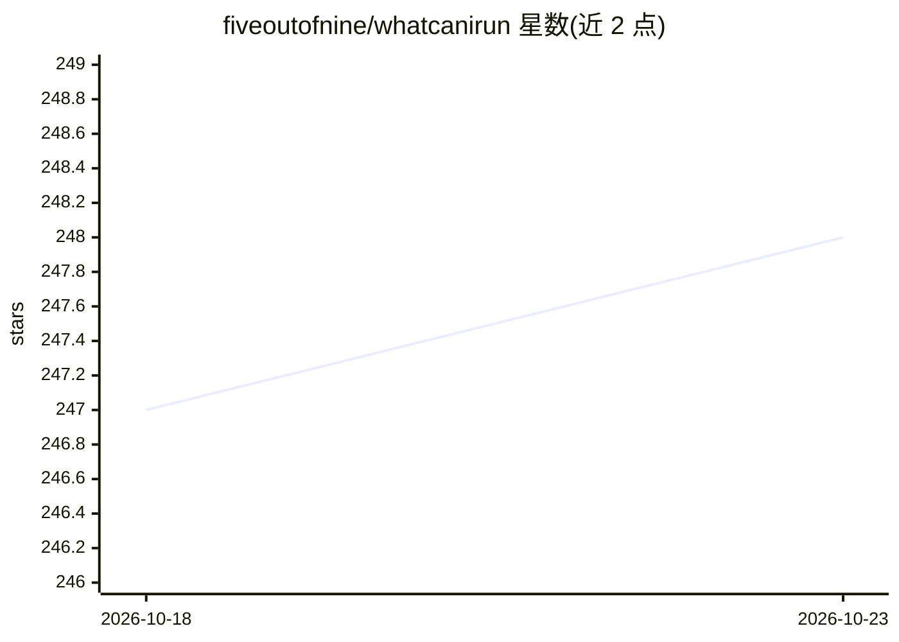

# fiveoutofnine/whatcanirun

⭐ 248 · TypeScript · MIT · 推送 2026-08-26 · [GitHub](https://github.com/fiveoutofnine/whatcanirun) · [官网](https://whatcani.run) · 个人维护

**查找可本地运行的 AI 模型并在本机跑基准测试的网站与 CLI**

由网站（whatcani.run）与 npm CLI（whatcanirun/wcir）组成的 monorepo：网站可浏览模型、按设备筛选、查看社区基准测试结果；CLI 在用户本地运行标准化的 LLM 基准测试并可提交结果，另提供查看设备、运行时、模型信息的命令。工程使用 Bun 与 Turborepo 构建，分为 Web 应用（Next.js）、CLI 与共享类型/工具包三部分，通过 git clone 后 bun install 从源码构建运行。

## 筛选速览

| 维度 | 判定 | 备注 |
|---|---|---|
| AI 角色 | `ai-ecosystem` | LLM/agent 周边工具 |
| 许可风险 | `permissive` | MIT |
| 部署形态 | `None` |  |
| 模型依赖 | — | README 未给出锁定关系 |
| 硬件要求 | — | 无带数字的原话,不猜 |
| 安装摩擦 | `low` | 无编译、无系统依赖或容器化 |
| 成熟度 | — | 结构信号不足 |

## 能力要点

- 网站支持按设备筛选模型并查看社区基准结果
- CLI 运行标准化本地 LLM 基准测试并可提交结果
- whatcanirun run/show/submit 三类命令
- Bun + Turborepo monorepo（web/CLI/共享包）

## 适用场景

- 想知道我的电脑能跑哪些本地 LLM
- 在本机跑标准化基准测试并分享结果
- 按设备筛选对比可本地运行的模型

## 场景标签

`模型评测` · 领域:评测与运维

## 证据(README 行号)

> L3: Find the best AI models you can run locally, and benchmark them on your hardware.
> L6: - **CLI**: `whatcanirun` (npm) — run standardized local LLM benchmarks and submit results

## 星数曲线

2026-10-18 247 → 2026-10-23 248（+1）

---
*卡片 v1 · prompt 1.4 · 生成 2026-10-22 · 置信度 high · 依据 README sha `79a4ff39a1ac` · [字段定义](../../DATASET.md)*
