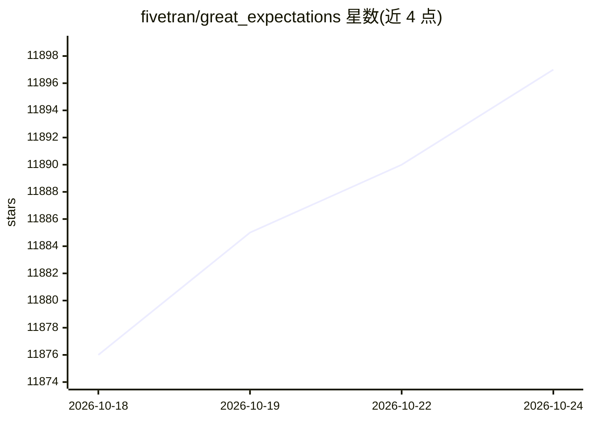

# fivetran/great_expectations

⭐ 11,897 · Python · Apache-2.0 · 推送 2026-10-22 · [GitHub](https://github.com/fivetran/great_expectations) · [官网](https://docs.greatexpectations.io/) · 组织维护

**数据团队的 Python 数据质量验证与剖析库**

GX Core 是用 Python 编写的开源数据质量框架：核心概念为 Expectations——对数据表达的可扩展单元测试，供数据团队以统一语言定义验证规则；每次验证结果可自动生成文档，用于团队协作与沉淀组织内数据知识。支持 Python 3.10–3.14，3.15 及以上可通过设置 GX_PYTHON_EXPERIMENTAL 环境变量启用实验性支持；官方建议部署在虚拟环境中，经 pip 安装后通过创建 Data Context 使用。README 未描述 AI/模型相关功能，本体为数据工程测试工具。

## 筛选速览

| 维度 | 判定 | 备注 |
|---|---|---|
| AI 角色 | `ai-enhanced` | 去掉 AI 部分产品仍成立 |
| 许可风险 | `permissive` | Apache-2.0 |
| 部署形态 | `library` | 以包/库形式分发 |
| 模型依赖 | — | README 未给出锁定关系 |
| 硬件要求 | — | 无带数字的原话,不猜 |
| 安装摩擦 | `low` | 无编译、无系统依赖或容器化 |
| 成熟度 | — | 结构信号不足 |

## 能力要点

- Expectations 形式的数据单元测试，可表达、可扩展
- 验证结果自动生成文档
- 支持 Python 3.10–3.14（3.15+ 实验性开关）
- 提供数据源与集成兼容性参考文档

## 适用场景

- 为数据管道定义并运行数据质量验证
- 数据团队以共同语言协作维护数据测试
- 为每次验证生成文档以留存数据知识

## 场景标签

 · 领域:数据工程/数据质量

## 证据(README 行号)

> L16: Its powerful technical tools start with Expectations: expressive and extensible unit tests for your data. Expectati
> L22: GX Core supports Python `3.10` through `3.14`.

## 星数曲线

2026-10-18 11,876 → 2026-10-24 11,897（+21）

---
*卡片 v1 · prompt 1.4 · 生成 2026-10-20 · 置信度 low · 依据 README sha `35498754af37` · [字段定义](../../DATASET.md)*
