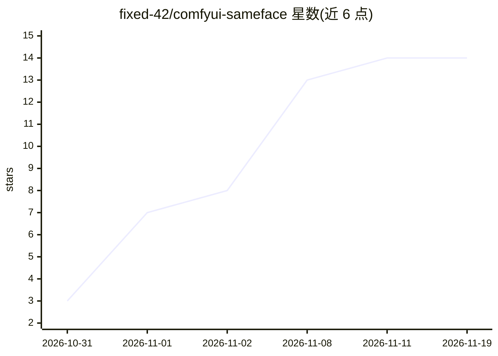

# fixed-42/comfyui-sameface

⭐ 14 · Python · Apache-2.0 · 推送 2026-10-30 · [GitHub](https://github.com/fixed-42/comfyui-sameface) · 个人维护

**测量并修复图像编辑导致的脸部形变的 ComfyUI 节点**

一组 ComfyUI 自定义节点，用光流（RAFT，在 Grounded SAM 2 面部掩码内）追踪脸部每个点从原图到编辑图的位移，剔除整体平移、缩放与旋转后，以面部尺寸百分比报告残余漂移，并通过薄板样条扭曲将脸部移回。开放权重，本地运行，无 API 调用。提供 Simple 与 Advanced 两组节点及示例工作流。限制：不测相似度、不能检测刻意修改、不适用于转头或多人图像，小于约 0.1% 的漂移读数偏低。

## 筛选速览

| 维度 | 判定 | 备注 |
|---|---|---|
| AI 角色 | `ai-native` | 本体是模型或模型工具 |
| 许可风险 | `permissive` | Apache-2.0 |
| 部署形态 | `library` | 以包/库形式分发 |
| 模型依赖 | — | README 未给出锁定关系 |
| 硬件要求 | `gpu-8g` | |
| 安装摩擦 | `low` | 无编译、无系统依赖或容器化 |
| 成熟度 | — | 结构信号不足 |

## 能力要点

- RAFT 光流 + Grounded SAM 2 掩码的密集漂移测量，噪声底 0.01% 面部尺寸
- 薄板样条修复节点可将测得的漂移移回，修复后再次测量验证
- 提供 Measure/Face Mask/Repair/View/Shift Map/Histogram/Zones 七个节点与三个示例工作流
- 开放权重本地运行：Grounding DINO、SAM 2.1、RAFT，首次使用自动下载约 1.8 GB

## 适用场景

- 检查老照片修复/上色后脸部是否变形并修复
- 换发色/背景/光照等编辑时保持同一张脸
- 对比不同编辑模型在同一尺度下的漂移数据
- 为角色 LoRA 数据集筛查处理图片中的脸部漂移

## 场景标签

`图像生成` `图像视频处理` · 领域:内容生成

## 证据(README 行号)

> L3: **ComfyUI nodes that measure where an image edit moved the parts of a face,
> L14: SameFace follows every point of a face from the original into the edit with
> L192: No training, no API, nothing leaves the machine. The models download on first

## 星数曲线

2026-10-31 3 → 2026-11-19 14（+11）

---
*卡片 v1 · prompt 1.4 · 生成 2026-11-18 · 置信度 mid · 依据 README sha `8643738ba22a` · [字段定义](../../DATASET.md)*
