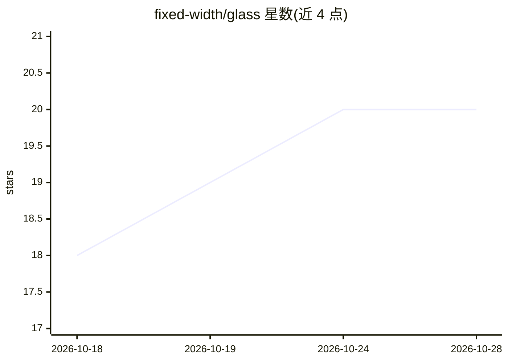

# fixed-width/glass

⭐ 20 · Rust · Apache-2.0 · 推送 2026-10-28 · [GitHub](https://github.com/fixed-width/glass) · [官网](https://fixedwidth.tech/glass) · 组织维护

**让编码 agent 驱动原生 GUI 应用的 MCP 服务器**

Rust 编写的 MCP 服务器，为 AI 编码 agent 提供对原生 GUI 应用的 build→see→interact→debug 闭环：启动应用、截屏、注入鼠标键盘输入、读取日志、检测视觉变化。以黑盒方式驱动应用，不依赖工具包或语言；后端覆盖 Linux（X11/Wayland）、Windows、macOS、Android（AVD 模拟器）与 iOS（Simulator）。支持无障碍树语义化定位，无树时按像素驱动；glass_diff 返回文本结果以减少视觉 token。各平台从 Releases 下载预编译产物，也可单条 cargo build 编译；输入隔离在 Windows/macOS 上当前共享桌面。

## 筛选速览

| 维度 | 判定 | 备注 |
|---|---|---|
| AI 角色 | `ai-ecosystem` | LLM/agent 周边工具 |
| 许可风险 | `permissive` | Apache-2.0 |
| 部署形态 | `desktop` | 安装包/桌面程序 |
| 模型依赖 | — | README 未给出锁定关系 |
| 硬件要求 | — | 无带数字的原话,不猜 |
| 安装摩擦 | `low` | 无编译、无系统依赖或容器化 |
| 成熟度 | — | 结构信号不足 |

## 能力要点

- 五平台后端：Linux/Windows/macOS/Android/iOS，平台无关核心
- 无障碍树语义化定位，无树时按像素驱动（screenshot/click/diff）
- glass_diff 返回 changed_pct+bbox 文本，减少截图与视觉 token 消耗
- --trace-dir 会话证据记录与 trace inspect/export 校验导出

## 适用场景

- 让编码 agent 自行运行并验证正在开发的 GUI 应用
- 从无障碍树复现并修复 UI 缺陷后重新验证
- 在桌面与移动模拟器上自动化驱动表单填写与保存等操作

## 场景标签

`GUI 自动化` · 领域:效率与自动化

## 证据(README 行号)

> L9: A Rust MCP server that gives an AI coding agent a closed **build →
> L37:  and connect it to your agent — glass works with any MCP host

## 星数曲线

2026-10-18 18 → 2026-10-28 20（+2）

---
*卡片 v1 · prompt 1.4 · 生成 2026-10-28 · 置信度 high · 依据 README sha `820c31f41039` · [字段定义](../../DATASET.md)*
