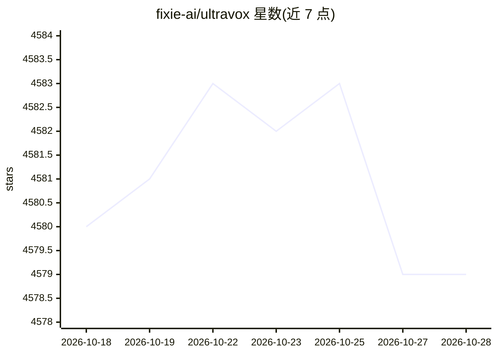

# fixie-ai/ultravox

⭐ 4,579 · Python · MIT · 推送 2025-12-12 · [GitHub](https://github.com/fixie-ai/ultravox) · [官网](https://ultravox.ai) · 组织维护

**实时语音多模态 LLM：音频直入 LLM，无需独立 ASR**

fixie-ai 开发的开源多模态 LLM，通过多模态投影器将音频直接映射到 LLM 的向量空间，省去独立 ASR 阶段，输入音频、输出流式文本，面向实时语音交互场景。默认版本基于 Llama 3.3 70B，另有 8B 变体，权重托管于 Hugging Face。仓库提供训练与评测流程：基于 Poetry/just 的环境安装，冻结 LLM 与音频编码器仅训练适配器（v0.4 需 8xH100 约 2-3 小时），支持替换骨干模型、自有音频数据与新语言训练。当前语音输出尚需经语音 token 与 vocoder 转换的路线仍在演进中。

## 筛选速览

| 维度 | 判定 | 备注 |
|---|---|---|
| AI 角色 | `ai-native` | 本体是模型或模型工具 |
| 许可风险 | `permissive` | MIT |
| 部署形态 | `None` |  |
| 模型依赖 | — | README 未给出锁定关系 |
| 硬件要求 | — | 无带数字的原话,不猜 |
| 安装摩擦 | `low` | 无编译、无系统依赖或容器化 |
| 成熟度 | — | 结构信号不足 |

## 能力要点

- 音频经投影器直接进入 LLM 空间，无需独立 ASR 阶段
- 默认基于 Llama 3.3 70B，另有 8B 变体，权重在 Hugging Face
- 可对任意开放权重 LLM 重新训练适配器（支持指定 text-model/audio-model）
- 提供训练与评测配置及 just/poetry 工具链

## 适用场景

- 构建实时语音交互应用（配合官方 Realtime 平台或托管 API）
- 替换 LLM 或音频编码器骨干，训练自己的语音多模态模型
- 用自有音频数据为模型增加新语言支持

## 场景标签

`多模态` `微调` · 领域:感知与多模态

## 证据(README 行号)

> L3: A fast multimodal LLM designed for real-time voice interactions
> L20: Ultravox is a new kind of multimodal LLM that can understand text as well as human speech, without the need for a s
> L22: Ultravox currently takes in audio and emits streaming text. As we evolve the model, we'll train it to be able to em

## 星数曲线

2026-10-18 4,580 → 2026-10-28 4,579（-1）

---
*卡片 v1 · prompt 1.4 · 生成 2026-10-21 · 置信度 high · 依据 README sha `b27e3715f6f5` · [字段定义](../../DATASET.md)*
