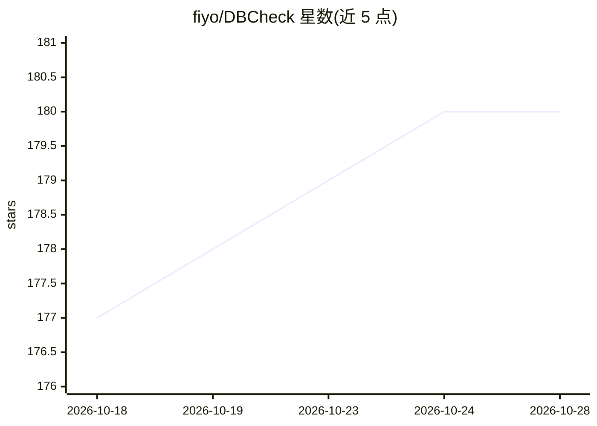

# fiyo/DBCheck

⭐ 180 · Python · Apache-2.0 · 推送 2026-10-27 · [GitHub](https://github.com/fiyo/DBCheck) · [官网](https://raccoonx.cn) · 个人维护 · 中文 README

**开源跨平台数据库巡检运维平台，AI 辅助诊断**

面向 DBA、数据库工程师与 DevOps 团队的巡检运维平台（原名 DBCheck）：连接 20+ 种数据库（MySQL/Oracle/DM8/OceanBase 等），用 800+ 条巡检规则检查配置、安全、性能、锁、索引、备份等维度，自动生成 Word 巡检报告。功能还包括慢 SQL 与锁诊断、实时监控、定时任务、SSH 终端、SQL 审计工单、数字孪生与工作流编排。AI 部分为辅助角色：Ollama 本地或云 API 的 AI 诊断、巡检对话、RAG 知识库与多专家智能中心。提供 Docker 镜像、Compose 部署与 Python 源码安装（Python 3.10+），Web UI 与 CLI 两种运行方式。

## 筛选速览

| 维度 | 判定 | 备注 |
|---|---|---|
| AI 角色 | `ai-enhanced` | 去掉 AI 部分产品仍成立 |
| 许可风险 | `permissive` | Apache-2.0 |
| 部署形态 | `desktop` | 安装包/桌面程序 |
| 模型依赖 | local-ok | 支持本地模型 |
| 硬件要求 | — | 无带数字的原话,不猜 |
| 安装摩擦 | `low` | 无编译、无系统依赖或容器化 |
| 成熟度 | — | 结构信号不足 |

## 能力要点

- 20+ 数据库类型、800+ 巡检规则，自动生成结构化 Word 报告
- AI 诊断支持本地 Ollama 或兼容云 API，含 RAG 知识库
- 慢 SQL/锁/索引/配置基线多维诊断与危险操作二次确认
- 插件化架构、工作流编排与多语言 UI（9 种语言）

## 适用场景

- 定期巡检多种生产数据库并自动出报告
- 分析慢 SQL、阻塞链与索引健康问题
- 把运维文档上传 RAG 知识库做 AI 辅助诊断

## 场景标签

`工作流自动化` `文档问答` · 领域:效率与自动化

## 证据(README 行号)

> L7: > **RaccoonX** is an open-source, cross-platform database inspection and operations platform designed for DBAs, data
> L116: |🤖 AI Diagnostics|Local Ollama or compatible cloud APIs for AI-assisted analysis|
> L122: |📚 RAG Knowledge Base|Upload operational documentation for AI-assisted diagnosis|

## 星数曲线

2026-10-18 177 → 2026-10-28 180（+3）

---
*卡片 v1 · prompt 1.4 · 生成 2026-10-22 · 置信度 mid · 依据 README sha `10c4d1ad05bf` · [字段定义](../../DATASET.md)*
