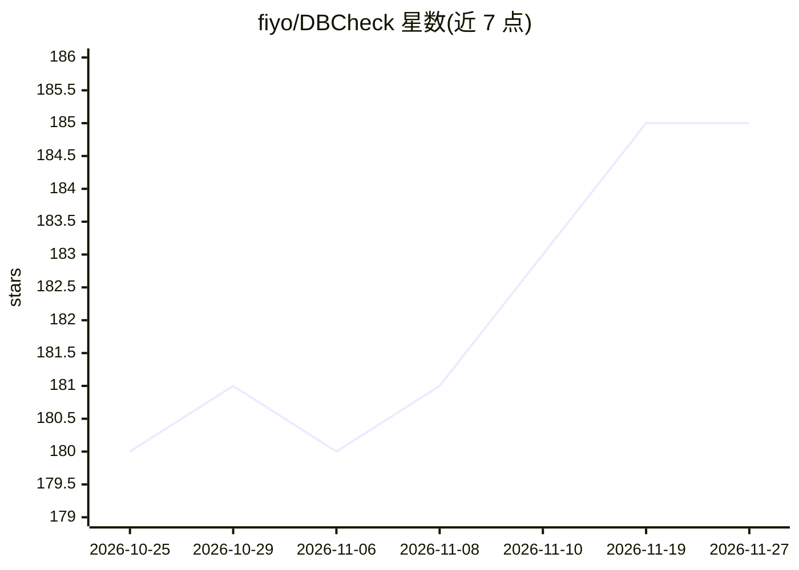

# fiyo/DBCheck

⭐ 185 · Python · Apache-2.0 · 推送 2026-11-26 · [GitHub](https://github.com/fiyo/DBCheck) · [官网](https://raccoonx.cn) · 个人维护 · 中文 README

**数据库巡检与运维平台：覆盖22种数据库、839条规则、AI诊断**

面向 DBA、数据库工程师、DevOps 与基础设施团队的跨平台数据库巡检与运维平台，前身为 DBCheck。支持 22 种数据库类型与 839 条巡检规则，功能包括数据源管理、慢查询分析、锁诊断、索引健康、配置基线、AWR 解析、Word 巡检报告生成、定时任务与实时监控。AI 相关机制包括本地 Ollama 或云 API 辅助诊断、自然语言巡检对话、RAG 知识库以及多专家协同的智能中心。提供 Docker 镜像（多架构含 arm64）、Linux 二进制与源码安装，含 MCP Server 与可视化工作流编排。

## 筛选速览

| 维度 | 判定 | 备注 |
|---|---|---|
| AI 角色 | `ai-enhanced` | 去掉 AI 部分产品仍成立 |
| 许可风险 | `permissive` | Apache-2.0 |
| 部署形态 | `desktop` | 安装包/桌面程序 |
| 模型依赖 | local-ok | 支持本地模型 |
| 硬件要求 | — | 无带数字的原话,不猜 |
| 安装摩擦 | `low` | 无编译、无系统依赖或容器化 |
| 成熟度 | — | 结构信号不足 |

## 能力要点

- 支持 22 种数据库类型与 839 条巡检规则，自动生成 Word 报告
- AI 诊断支持本地 Ollama 或兼容云 API，含 RAG 运维知识库
- MCP Server 暴露 12 个工具供 Claude、Cursor 等客户端调用
- 多架构 Docker 镜像（amd64/arm64）适配麒麟等国产服务器

## 适用场景

- 定时批量巡检生产环境多种数据库并生成巡检报告
- 慢 SQL、锁等待与索引健康的人工辅助诊断
- 信创环境下的数据库合规评估与国产数据库接入
- 通过 MCP 客户端以自然语言查询巡检系统

## 场景标签

`工作流自动化` · 领域:效率与自动化

## 证据(README 行号)

> L7: > **RaccoonX** is an open-source, cross-platform database inspection and operations platform designed for DBAs, data
> L115: |🤖 AI Diagnostics|Local Ollama or compatible cloud APIs for AI-assisted analysis|
> L23: > 🤖 **AI-assisted diagnostics**

## 星数曲线

2026-10-25 180 → 2026-11-27 185（+5）

---
*卡片 v1 · prompt 1.4 · 生成 2026-11-26 · 置信度 mid · 依据 README sha `3157b68bfb2c` · [字段定义](../../DATASET.md)*
