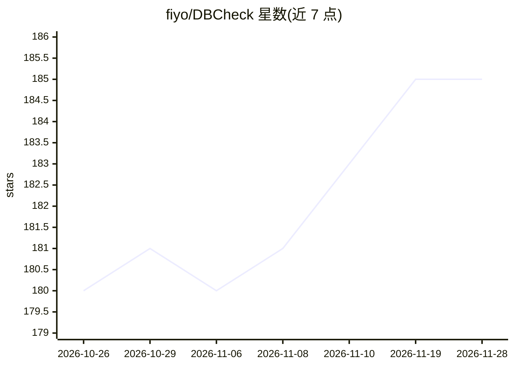

# fiyo/DBCheck

⭐ 185 · Python · Apache-2.0 · 推送 2026-11-27 · [GitHub](https://github.com/fiyo/DBCheck) · [官网](https://raccoonx.cn) · 个人维护 · 中文 README

**面向 DBA 与运维团队的数据库巡检与运维平台，含 AI 辅助诊断**

RaccoonX（原名 DBCheck）是开源、跨平台的数据库巡检与运维平台，支持 22 种数据库和 839 条巡检规则，覆盖慢查询分析、锁诊断、索引健康、配置基线、实时监控、定时任务与 Word 巡检报告等。AI 部分包括：本地 Ollama 或兼容云 API 的辅助分析、巡检自然语言对话、RAG 知识库，以及暴露 12 个工具的 MCP Server。提供 Docker、Linux 二进制与源码三种部署方式，支持 amd64/arm64 与麒麟等国产服务器环境，采用 Apache 2.0 许可。

## 筛选速览

| 维度 | 判定 | 备注 |
|---|---|---|
| AI 角色 | `ai-enhanced` | 去掉 AI 部分产品仍成立 |
| 许可风险 | `permissive` | Apache-2.0 |
| 部署形态 | `desktop` | 安装包/桌面程序 |
| 模型依赖 | local-ok | 支持本地模型 |
| 硬件要求 | — | 无带数字的原话,不猜 |
| 安装摩擦 | `low` | 无编译、无系统依赖或容器化 |
| 成熟度 | — | 结构信号不足 |

## 能力要点

- 支持 22 种数据库类型与 839 条巡检规则，自动生成 Word 巡检报告
- AI 诊断支持本地 Ollama 或兼容云 API，含 RAG 知识库与巡检对话
- MCP Server 暴露 12 个工具（9 只读 + 3 写操作需审批）供 Claude、Cursor 等 MCP 客户端调用
- 多架构镜像与 Linux 二进制支持麒麟/ARM64 国产服务器部署

## 适用场景

- 对生产环境的多种数据库执行批量巡检并生成报告
- 用 AI 辅助分析慢 SQL 与锁等待问题
- 通过 MCP 客户端以自然语言查询巡检系统
- 在麒麟/ARM64 国产服务器上部署数据库运维平台

## 场景标签

`RAG` · 领域:知识与检索

## 证据(README 行号)

> L7: > **RaccoonX** is an open-source, cross-platform database inspection and operations platform designed for DBAs, data
> L115: |🤖 AI Diagnostics|Local Ollama or compatible cloud APIs for AI-assisted analysis|
> L122: |📚 RAG Knowledge Base|Upload operational documentation for AI-assisted diagnosis|

## 星数曲线

2026-10-26 180 → 2026-11-28 185（+5）

---
*卡片 v1 · prompt 1.4 · 生成 2026-11-27 · 置信度 high · 依据 README sha `5e66be88ff65` · [字段定义](../../DATASET.md)*
