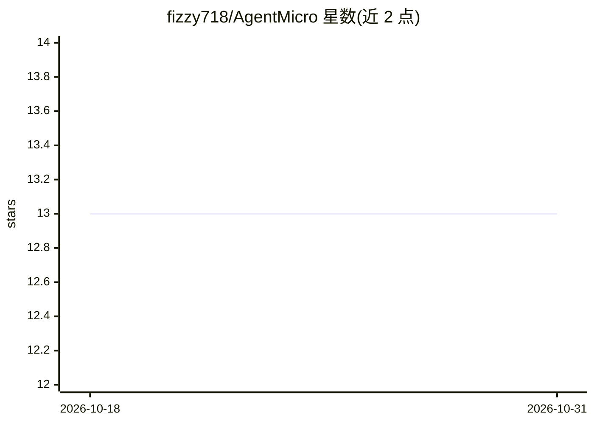

# fizzy718/AgentMicro

⭐ 13 · Swift · MIT · 推送 2026-08-19 · [GitHub](https://github.com/fizzy718/AgentMicro) · [官网](https://agentmicro.cc) · 个人维护 · 中文 README

**macOS 菜单栏监控多个 Codex 任务状态的本地工具**

本地优先的 macOS 菜单栏应用，面向同时运行多个 Codex 任务的 macOS 用户：读取本地 Codex 进程与会话元数据，以五色状态（Idle/Unread/Thinking/Needs input/Error）显示任务队列，支持一键跳转 Codex Desktop 对话、显示项目名与当前轮次时长、登录启动、23 种界面语言。通过文件系统事件加轮询更新状态，不读取 Keychain、不要求完全磁盘访问、不上传任何任务数据。V1 仅观察与返回任务，不执行批准/停止/继续操作，不监控 token 配额。基于 CodexBar 代码库派生，非 OpenAI 官方项目。

## 筛选速览

| 维度 | 判定 | 备注 |
|---|---|---|
| AI 角色 | `ai-ecosystem` | LLM/agent 周边工具 |
| 许可风险 | `permissive` | MIT |
| 部署形态 | `None` |  |
| 模型依赖 | — | README 未给出锁定关系 |
| 硬件要求 | — | 无带数字的原话,不猜 |
| 安装摩擦 | `low` | 无编译、无系统依赖或容器化 |
| 成熟度 | — | 结构信号不足 |

## 能力要点

- 五状态色彩系统监控 Codex Desktop 与 CLI 任务
- 只读本地元数据，不上传提示词/代码/响应
- 一键跳转对应 Codex Desktop 对话
- 可选增强状态检测，默认关闭且不自动点击输入

## 适用场景

- 同时跑多个 Codex 任务时在菜单栏查看队列状态
- 及时发现等待批准或出错的任务
- 在共享屏幕时用仅项目名显示模式保护任务标题隐私

## 场景标签

 · 领域:开发者工具/AI 任务监控

## 证据(README 行号)

> L16: AgentMicro is a small, local-first macOS menu bar companion for people running several Codex tasks at once. It show
> L56: - Observes local Codex Desktop and Codex CLI tasks.

## 星数曲线

2026-10-18 13 → 2026-10-31 13（+0）

---
*卡片 v1 · prompt 1.4 · 生成 2026-10-31 · 置信度 high · 依据 README sha `f1a7247e317e` · [字段定义](../../DATASET.md)*
