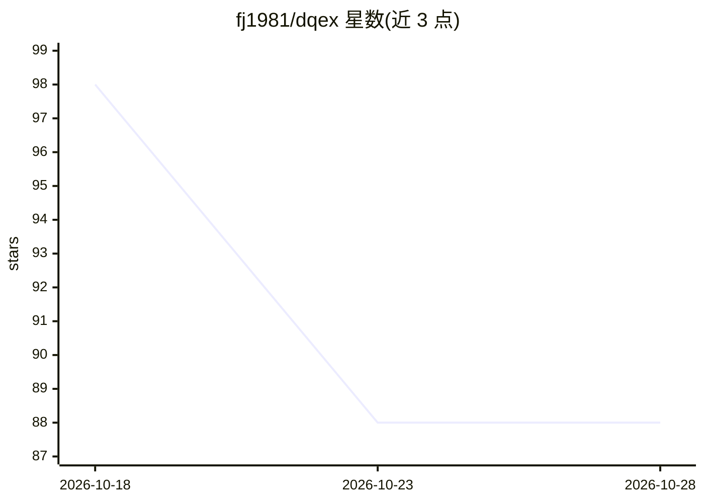

# fj1981/dqex

⭐ 88 · Go · MIT · 推送 2026-10-10 · [GitHub](https://github.com/fj1981/dqex) · 个人维护 · 中文 README

**离线优先的单文件数据库工作台，含 AI 辅助 SQL 生成**

跨平台数据库工作台，以单个静态二进制文件分发，无需 JVM、Electron 或网络。功能覆盖导入、导出、跨方言迁移（MySQL→PostgreSQL 等）、库比较、快照生命周期、Excel 数据字典生成与 SQL 终端，Web UI 与 CLI 共用同一引擎，支持 MySQL/PostgreSQL/Oracle。AI 部分为可选的辅助 SQL 生成：agent 先读取真实表结构再生成方言正确的 SQL，写操作需确认，未配置时不渲染入口；另有离线 SQL 模板库。面向受限网络与隔离环境的运维/开发人员。限制：仅支持三种数据库引擎。

## 筛选速览

| 维度 | 判定 | 备注 |
|---|---|---|
| AI 角色 | `ai-enhanced` | 去掉 AI 部分产品仍成立 |
| 许可风险 | `permissive` | MIT |
| 部署形态 | `desktop` | 安装包/桌面程序 |
| 模型依赖 | — | README 未给出锁定关系 |
| 硬件要求 | — | 无带数字的原话,不猜 |
| 安装摩擦 | `medium` | 含编译或系统依赖之一 |
| 成熟度 | — | 结构信号不足 |

## 能力要点

- 单静态二进制分发，无需 JVM/Electron/网络，可离线运行
- AI 辅助 SQL：读取真实 schema 生成方言正确 SQL，写操作需确认，支持离线模板回退
- MySQL/PostgreSQL/Oracle 跨方言迁移与 schema/数据比较
- 一键生成审计用 Excel 数据字典与快照差异报告

## 适用场景

- 在隔离网络环境中做数据库导出、迁移与比较
- 生成符合审计要求的数据字典与快照差异报告
- 让 AI 读取真实表结构生成跨方言 SQL 并经确认后执行

## 场景标签

`数据分析` · 领域:效率与自动化

## 证据(README 行号)

> L20: dqex is a cross-platform database workbench that ships as a **single static binary** — no JVM, no Electron, no inst
> L24: - 🤖 **AI that cannot surprise you** — it reads your *real* schema before writing anything, generates dialect-correc
> L91: |AI-Assisted SQL|✅|`\ai` in `sql`|Agent probes real schema, generates SQL per dialect, requires confirmation|

## 星数曲线

2026-10-18 98 → 2026-10-28 88（-10）

---
*卡片 v1 · prompt 1.4 · 生成 2026-10-23 · 置信度 high · 依据 README sha `c5494d8329ad` · [字段定义](../../DATASET.md)*
