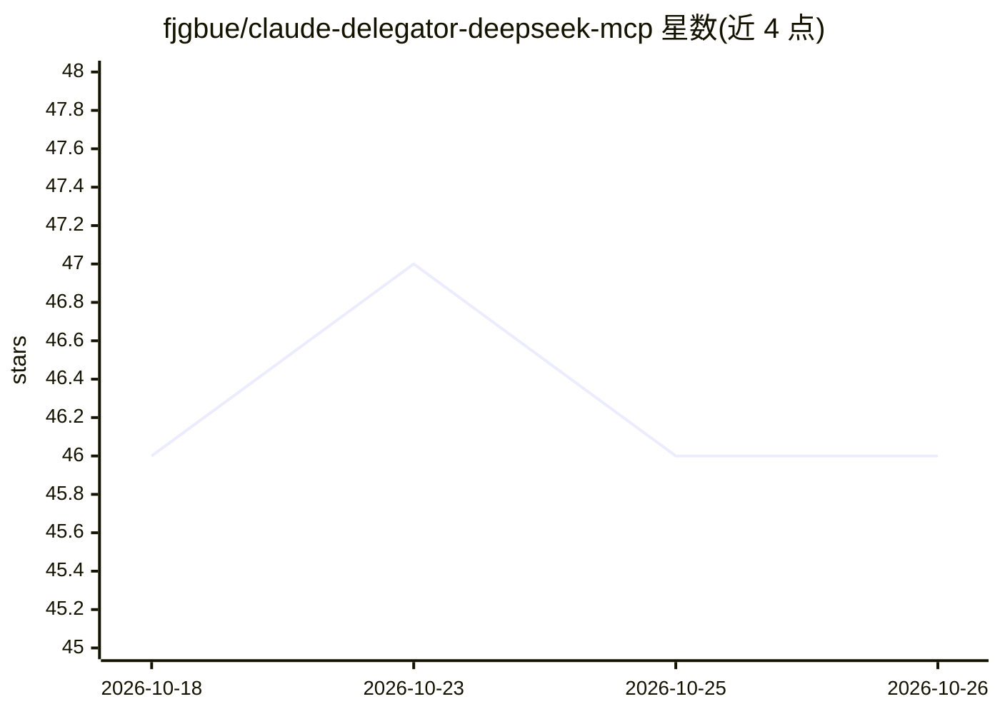

# fjgbue/claude-delegator-deepseek-mcp

⭐ 46 · JavaScript · MIT · 推送 2026-09-24 · [GitHub](https://github.com/fjgbue/claude-delegator-deepseek-mcp) · 个人维护

**Claude Code 的 MCP 委派服务器：把重 token 任务转给低价模型**

面向 Claude Code 用户的 MCP server：把大文件审计、长文生成、深度推理等重 token 任务委派给 DeepSeek、Kimi、GLM、Qwen、Grok 等更低价的模型，可按任务混用多家 provider，包括本地 ollama/vllm。提供 npx 一条命令交互式安装向导（配置 provider、API key 实时校验、模型路由策略），每次调用后显示基于 API token 计数的费用回执。通过 files[] 参数让服务端直接读盘转发文件字节，避免文件内容进入 Claude 上下文。零依赖，以 npm 包分发。

## 筛选速览

| 维度 | 判定 | 备注 |
|---|---|---|
| AI 角色 | `ai-ecosystem` | LLM/agent 周边工具 |
| 许可风险 | `permissive` | MIT |
| 部署形态 | `library` | 以包/库形式分发 |
| 模型依赖 | local-ok | 支持本地模型 |
| 硬件要求 | — | 无带数字的原话,不猜 |
| 安装摩擦 | `low` | 无编译、无系统依赖或容器化 |
| 成熟度 | — | 结构信号不足 |

## 能力要点

- 内置 8 家 provider 并支持任意 OpenAI 兼容端点（含本地 ollama/vllm）
- 按任务类型（read/write/reason）路由到不同模型，可混用多家 provider
- files[] 机制：服务端直接读盘转发，文件字节不进入 Claude 上下文
- 每次调用显示基于 API 自身 token 计数的费用回执

## 适用场景

- 把大文件审计等重任务委派给低价模型以降低 Claude Code 账单
- 在 Claude Code 内混用多家模型：读取用便宜模型、写码用强模型
- 接入本地 ollama/vllm 实现 $0 委派

## 场景标签

`模型网关` · 领域:Agent 开发

## 证据(README 行号)

> L8: Claude orchestrates; the delegate does the grunt work (big file audits, long generations, deep reasoning) at a fract
> L63: 4. **An MCP server** named `delegate` (`npx -y claude-code-deepseek-delegator`) — so Claude Code shows "Calling del
> L174: |Param|Type|Default|Description|

## 星数曲线

2026-10-18 46 → 2026-10-26 46（+0）

---
*卡片 v1 · prompt 1.4 · 生成 2026-10-25 · 置信度 high · 依据 README sha `5a1ca6be807e` · [字段定义](../../DATASET.md)*
