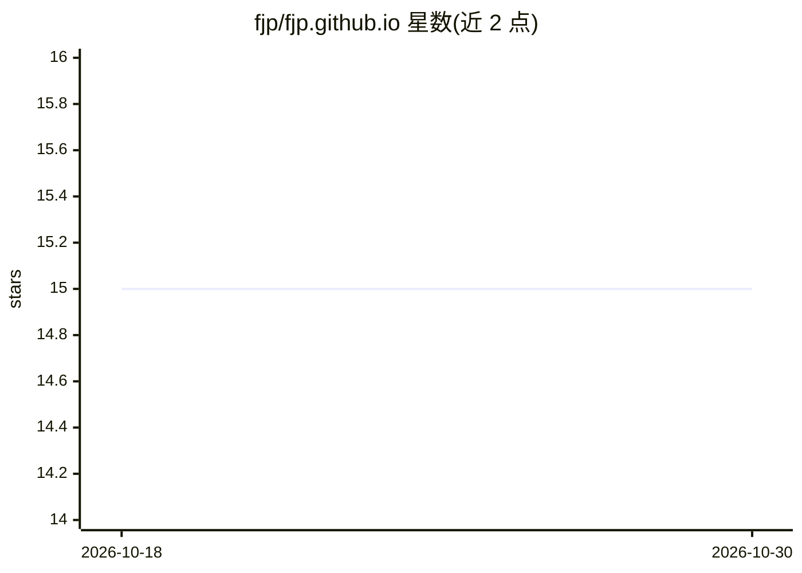

# fjp/fjp.github.io

⭐ 15 · HTML · MIT · 推送 2026-10-13 · [GitHub](https://github.com/fjp/fjp.github.io) · [官网](https://fjp.github.io) · 个人维护

**个人 Jekyll 博客仓库，基于 minimal-mistakes 主题托管于 GitHub Pages**

存放个人博客数据的仓库，使用 minimal-mistakes Jekyll 主题，通过 GitHub Pages 在推送后自动构建为静态站点，主题在 _config.yml 中配置。README 记录了 Ubuntu 22.04 与 macOS 上的环境搭建步骤（rvm 安装 Ruby、Jekyll 与 Bundler gems、bundle exec jekyll serve），以及新建文章的目录约定；后半部分为所引用的 minimal-mistakes 主题自带的说明（功能、皮肤、安装方法），非本仓库自身开发内容。仓库主题标签涉及自动驾驶、计算机视觉、深度学习等。

## 筛选速览

| 维度 | 判定 | 备注 |
|---|---|---|
| AI 角色 | `ai-knowledge` | 知识聚合/清单类 |
| 许可风险 | `permissive` | MIT |
| 部署形态 | `None` |  |
| 模型依赖 | — | README 未给出锁定关系 |
| 硬件要求 | — | 无带数字的原话,不猜 |
| 安装摩擦 | `low` | 无编译、无系统依赖或容器化 |
| 成熟度 | — | 结构信号不足 |

## 能力要点

- 基于 minimal-mistakes 主题，GitHub Pages 推送后自动构建静态站点
- 提供 Ubuntu/macOS 的 Ruby + Jekyll 环境搭建与本地预览步骤
- 支持 CNAME 自定义域名配置

## 适用场景

- 搭建个人 GitHub Pages 博客并本地预览
- 参考其环境搭建步骤复现同类 Jekyll 站点
- 了解 minimal-mistakes 主题的安装与配置方式

## 场景标签

 · 领域:个人网站/静态博客

## 证据(README 行号)

> L1: # Blog Repository
> L4: `_config.yml`, an important configuration file for sites based on Jekyll. Whenever I push commits to this GitHub rep

## 星数曲线

2026-10-18 15 → 2026-10-30 15（+0）

---
*卡片 v1 · prompt 1.4 · 生成 2026-10-30 · 置信度 low · 依据 README sha `0c81775fb004` · [字段定义](../../DATASET.md)*
