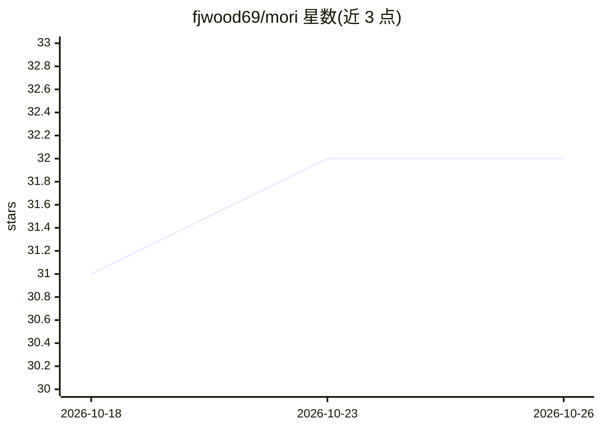

# fjwood69/mori

⭐ 32 · Python · AGPL-3.0 · 推送 2026-10-20 · [GitHub](https://github.com/fjwood69/mori) · [官网](https://moriapp.dev/) · 个人维护

**面向 AI 编程 agent 的自托管治理型共享记忆层（MCP server）**

Mori 是一个自托管、agent 中立的 MCP server，为 Claude Code、Codex、Cursor、OpenCode、Antigravity、Cline 等编程 agent 提供共享记忆：通过 agent 生命周期 hook 捕获会话事件，dream pipeline 用可配置的 LLM 将事件蒸馏为结构化候选记忆，经人工审核（curation queue）晋升为规范记忆；记忆按来源（provenance）限定适用范围，会话开始时经 /brief 注入共享上下文。提供治理功能：分级 API key、版本化、回滚、写审计。部署方式含 Homebrew、Docker Compose 及 Render/Railway/Fly/Cloud Run 一键部署，数据存 SQLite FTS5 或 Postgres。README 明确声明不控制 agent 行为，强制执行（governed playbooks）已构建并基准测试但尚未作为产品面交付。

## 筛选速览

| 维度 | 判定 | 备注 |
|---|---|---|
| AI 角色 | `ai-ecosystem` | LLM/agent 周边工具 |
| 许可风险 | `viral` | AGPL-3.0 |
| 部署形态 | `self-host` | docker 或自建部署 |
| 模型依赖 | — | README 未给出锁定关系 |
| 硬件要求 | — | 无带数字的原话,不猜 |
| 安装摩擦 | `low` | 无编译、无系统依赖或容器化 |
| 成熟度 | — | 结构信号不足 |

## 能力要点

- dream pipeline 将多实例会话事件蒸馏为结构化记忆，人工审核后晋升
- provenance 限定记忆适用范围，默认 MORI_BRIEF_SCOPE 防跨仓库记忆污染
- 插件包同时支持 Claude Code / OpenCode / Codex / Cursor / Antigravity，另有 Cline 脚本
- 治理功能：分级 API key、版本化、回滚、store.write 写审计、可信 dreamer 审核

## 适用场景

- 团队多机多实例的编程 agent 共享决策与模式记忆
- 跨仓库场景下按来源限定记忆适用范围，避免 agent 引用不存在的 API
- 将 PDF、图片、git、transcript 统一摄入共享记忆库并全文检索

## 场景标签

`Agent 记忆` `多智能体` · 领域:Agent 开发

## 证据(README 行号)

> L1: mori — A governed shared memory layer for AI coding agents
> L63: **all instances** into a unified memory store, and `/brief` surfaces them at the start of
> L139: The same plugin package (`plugins/mori/`) also targets **OpenCode**, **Codex**,

## 星数曲线

2026-10-18 31 → 2026-10-26 32（+1）

---
*卡片 v1 · prompt 1.4 · 生成 2026-10-26 · 置信度 high · 依据 README sha `8c4a7ac098f4` · [字段定义](../../DATASET.md)*
