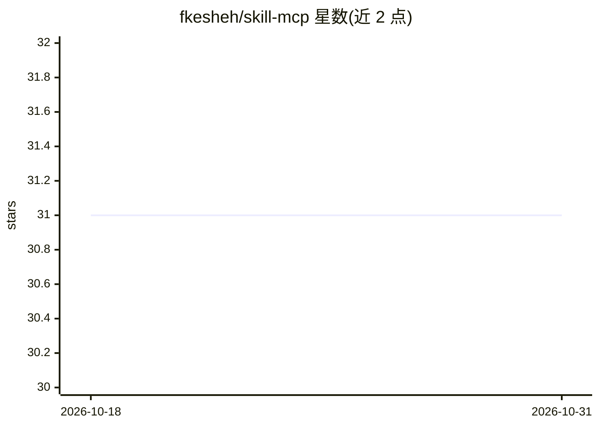

# fkesheh/skill-mcp

⭐ 31 · Python · MIT · 推送 2025-11-14 · [GitHub](https://github.com/fkesheh/skill-mcp) · 个人维护

**让 LLM 通过 MCP 编程管理技能的 Python 服务器**

面向 Claude Desktop、claude.ai、Cursor 等 MCP 客户端的技能管理服务器：以 5 个统一 CRUD 工具对 ~/.skill-mcp/skills 目录下的技能做增删改查，由 LLM 程序化创建、编辑与执行技能脚本，免去手工压缩上传。执行层支持 Python/Bash 脚本、PEP 723 内联依赖声明（经 uv 自动隔离安装）、跨技能导入时自动聚合依赖与环境变量，并在单次执行中组合多个技能。经 uvx 从 PyPI 拉取运行，无需本地服务文件；脚本执行设 30 秒超时。

## 筛选速览

| 维度 | 判定 | 备注 |
|---|---|---|
| AI 角色 | `ai-ecosystem` | LLM/agent 周边工具 |
| 许可风险 | `permissive` | MIT |
| 部署形态 | `library` | 以包/库形式分发 |
| 模型依赖 | — | README 未给出锁定关系 |
| 硬件要求 | — | 无带数字的原话,不猜 |
| 安装摩擦 | `low` | 无编译、无系统依赖或容器化 |
| 成熟度 | — | 结构信号不足 |

## 能力要点

- 5 个统一 CRUD 工具实现 LLM 程序化技能管理
- execute_python_code 支持跨技能导入并自动聚合 PEP 723 依赖与环境变量
- 同一技能目录可被 Cursor、Claude Desktop 等 MCP 客户端共用
- 通过 uvx 从 PyPI 自动下载运行，无需本地安装服务文件

## 适用场景

- 在 MCP 客户端中让 LLM 直接创建、修改并测试技能脚本
- 把多个技能的工具模块组合到一次 Python 执行中处理数据流程
- 在 Cursor 与 Claude 间共享同一份技能目录

## 场景标签

`Agent 框架` · 领域:Agent 开发

## 证据(README 行号)

> L3: A Model Context Protocol (MCP) server that enables Claude to manage skills stored in `~/.skill-mcp/skills`. This sys
> L18: 1. **MCP Server** (`src/skill_mcp/server.py`) - A Python package providing 5 unified CRUD tools for skill managemen
> L52: - ✅ **Universal** - Works with Claude Desktop, claude.ai, Cursor, and any MCP-compatible client

## 星数曲线

2026-10-18 31 → 2026-10-31 31（+0）

---
*卡片 v1 · prompt 1.4 · 生成 2026-10-26 · 置信度 high · 依据 README sha `b34227787052` · [字段定义](../../DATASET.md)*
