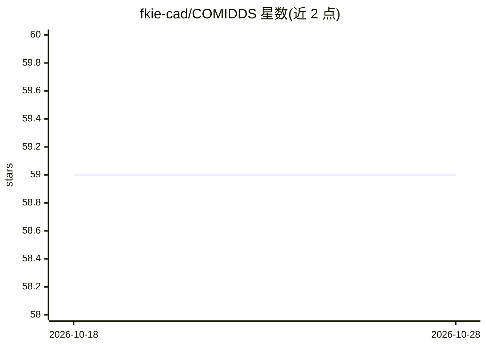

# fkie-cad/COMIDDS

⭐ 59 · HTML · MIT · 推送 2026-05-29 · [GitHub](https://github.com/fkie-cad/COMIDDS) · 组织维护

**面向研究者的入侵检测数据集综述清单（企业网络场景）**

以 GitHub Pages 网站形式呈现的入侵检测数据集综述项目：收录面向企业网络（办公浏览、邮件、Web/数据库服务等场景）入侵检测方法研发与评估的数据集，提供总表与每个数据集的独立页面（关键特性、环境、活动与所含数据描述及链接），帮助研究者查找和选择合适数据。明确排除工控系统、互联网交换点等差异环境的的数据集。附论文引用条目与版本化发布引用建议，接受协作贡献。

## 筛选速览

| 维度 | 判定 | 备注 |
|---|---|---|
| AI 角色 | `ai-knowledge` | 知识聚合/清单类 |
| 许可风险 | `permissive` | MIT |
| 部署形态 | `None` |  |
| 模型依赖 | — | README 未给出锁定关系 |
| 硬件要求 | — | 无带数字的原话,不猜 |
| 安装摩擦 | `low` | 无编译、无系统依赖或容器化 |
| 成熟度 | — | 结构信号不足 |

## 能力要点

- 数据集总表 + 每数据集独立详情页（特性/环境/数据描述）
- 聚焦企业网络入侵检测，明确排除工控等环境
- 提供论文引用与按 release 版本引用的规范
- 以协作方式持续维护，需通过 github.io 站点浏览

## 适用场景

- 为入侵检测方法研究查找合适的数据集
- 比较各数据集的环境、活动与所含数据以决定选型
- 学术写作中规范引用该综述与具体数据集信息

## 场景标签

`精选清单` `网络安全` · 领域:学习与行业

## 证据(README 行号)

> L9: This repository contains the website for *COMIDDS*, an overview of datasets for research in intrusion detection.
> L10: Our goal is to provide a comprehensive and detailed list of relevant datasets along with descriptions and links, ai
> L13: We mainly focus on datasets suited for developing and evaluating methods for intrusion detection in enterprise netw

## 星数曲线

2026-10-18 59 → 2026-10-28 59（+0）

---
*卡片 v1 · prompt 1.4 · 生成 2026-10-24 · 置信度 high · 依据 README sha `31932e3e2253` · [字段定义](../../DATASET.md)*
