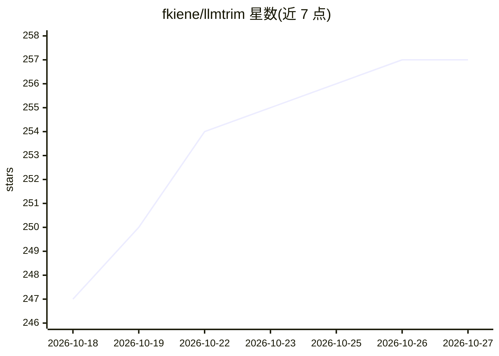

# fkiene/llmtrim

⭐ 257 · Rust · MPL-2.0 · 推送 2026-10-20 · [GitHub](https://github.com/fkiene/llmtrim) · [官网](https://www.npmjs.com/package/@llmtrim/cli) · 个人维护

**本地代理：压缩 LLM API 请求以降低 token 费用，回答不变**

运行在用户本机的 MITM 式代理，拦截发往 LLM API 的请求，对构建日志、长上下文、源码、工具 schema、大型 JSON 等做多级压缩后再转发，回复保持不变，实测约 −31% 输入 / −74% 输出。以 npm/curl/brew/Scoop/Cargo/Docker 安装，setup 配置 CA 与 HTTPS_PROXY，任何遵循 HTTPS_PROXY 的工具（Claude Code、Codex、Cursor 等）可用；GitHub Copilot 因证书固定不支持。另提供 CLI、MCP 服务器及 Rust/Python/Ruby/Kotlin/Swift/JS 库形态。附带 Claude Code /sub 订阅重路由功能（经 CLIProxyAPI，README 注明可能与 provider ToS 冲突）。压缩分 10 级，每级用 provider 实际 tokenizer 复测，不省 token 即回退。

## 筛选速览

| 维度 | 判定 | 备注 |
|---|---|---|
| AI 角色 | `ai-ecosystem` | LLM/agent 周边工具 |
| 许可风险 | `permissive` | MPL-2.0 |
| 部署形态 | `library` | 以包/库形式分发 |
| 模型依赖 | — | README 未给出锁定关系 |
| 硬件要求 | — | 无带数字的原话,不猜 |
| 安装摩擦 | `low` | 无编译、无系统依赖或容器化 |
| 成熟度 | — | 结构信号不足 |

## 能力要点

- 本地 MITM 代理压缩 LLM 请求，任何遵循 HTTPS_PROXY 的工具可用
- 10 级压缩：日志折叠、BM25 检索、tree-sitter 骨架化、TOON 序列化等
- 每级用 provider 实际 tokenizer 复测，不节省则回退，最坏零节省
- 同一引擎另提供 CLI、MCP 服务器与 Rust/Python/Ruby/Kotlin/Swift/JS 库

## 适用场景

- 降低 Claude Code / Codex / Cursor 等 agent 工具的 API 账单
- 在发送前压缩构建日志、工具输出与长上下文
- 以嵌入库形式在自有应用内做请求压缩，无需模型调用

## 场景标签

`模型网关` · 领域:Agent 开发

## 证据(README 行号)

> L40: llmtrim sits on your machine as a local proxy, trims the waste, and forwards a smaller request. The reply is unchan
> L43:   before:  your tool ───── full request ─────▶  OpenAI / Anthropic / …
> L71: > Any tool that honors `HTTPS_PROXY` works (Claude Code, Codex, Cursor, Aider, your SDK). GitHub Copilot does not (

## 星数曲线

2026-10-18 247 → 2026-10-27 257（+10）

---
*卡片 v1 · prompt 1.4 · 生成 2026-10-22 · 置信度 high · 依据 README sha `a0ef8204f373` · [字段定义](../../DATASET.md)*
