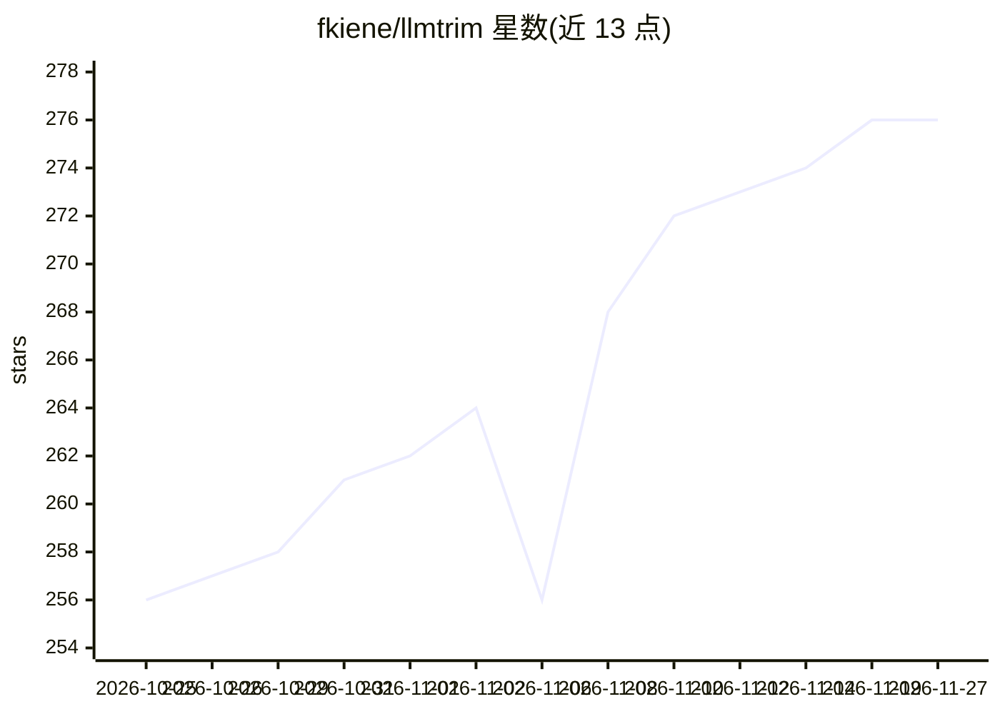

# fkiene/llmtrim

⭐ 276 · Rust · MPL-2.0 · 推送 2026-11-24 · [GitHub](https://github.com/fkiene/llmtrim) · [官网](https://www.npmjs.com/package/@llmtrim/cli) · 个人维护

**本地代理压缩 LLM API 请求，降低 token 费用**

运行在本机的 MITM 代理，截获发往 LLM API 的请求，经 10 个压缩阶段（日志折叠、BM25 上下文检索、tree-sitter 代码骨架化、TOON/CSV 序列化、图片降采样等）裁剪冗余 token 后转发，响应内容不变；每阶段用提供方真实 tokenizer 复测，不省即撤销，最坏情况为零节省。另提供 CLI、MCP server 与多语言库（Rust/Python/Ruby/Swift/Kotlin/JS），支持 Claude Code 的 /sub 会话路由与菜单栏托盘。

## 筛选速览

| 维度 | 判定 | 备注 |
|---|---|---|
| AI 角色 | `ai-ecosystem` | LLM/agent 周边工具 |
| 许可风险 | `permissive` | MPL-2.0 |
| 部署形态 | `library` | 以包/库形式分发 |
| 模型依赖 | — | README 未给出锁定关系 |
| 硬件要求 | — | 无带数字的原话,不猜 |
| 安装摩擦 | `low` | 无编译、无系统依赖或容器化 |
| 成熟度 | — | 结构信号不足 |

## 能力要点

- 10 个压缩阶段按节省顺序运行，cache_control 前缀不动
- 实测 −31% 输入 / −74% 输出，~5ms/调用，无额外模型调用
- 同引擎可作为代理、CLI 管道、MCP server 或 6 种语言库使用
- Claude Code /sub 订阅路由与 CLIProxyAPI 回退跳

## 适用场景

- 使用 Claude Code/Codex/Cursor 等 agent 工具时降低 API 账单
- 自己开发的应用调用 LLM API 前压缩请求体
- 在 CLI 管道或应用内以库形式做请求压缩

## 场景标签

`提示工程` `模型网关` · 领域:Agent 开发

## 证据(README 行号)

> L5:  Local proxy that compresses LLM API traffic so you pay less. Same answers, smaller bill.
> L40: llmtrim sits on your machine as a local proxy, trims the waste, and forwards a smaller request. The reply is unchan
> L251: Same engine, no proxy required. No extra model calls; compress runs in-process.

## 星数曲线

2026-10-25 256 → 2026-11-27 276（+20）

---
*卡片 v1 · prompt 1.4 · 生成 2026-11-26 · 置信度 high · 依据 README sha `9dab5f4aceb0` · [字段定义](../../DATASET.md)*
