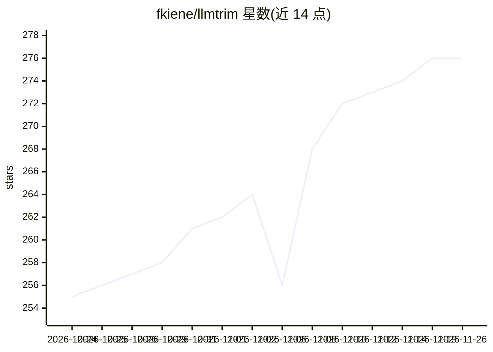

# fkiene/llmtrim

⭐ 276 · Rust · MPL-2.0 · 推送 2026-11-24 · [GitHub](https://github.com/fkiene/llmtrim) · [官网](https://www.npmjs.com/package/@llmtrim/cli) · 个人维护

**本地代理压缩 LLM API 请求以降低费用，答案不变**

运行于用户本机的 MITM 代理，拦截发往 OpenAI/Anthropic 等 LLM API 的请求，经 10 个压缩阶段（工具输出折叠、BM25 上下文检索、tree-sitter 代码骨架化、JSON 采样等）削减 token 后转发；每阶段用 provider 真实 tokenizer 复测，不省即撤销，失败则回发原文。同引擎提供 CLI、MCP 服务器与 Rust/Python/Ruby/Kotlin/Swift/JS 多语言库。附带 Claude Code 的 /sub 订阅重路由（经 CLIProxyAPI）与系统托盘面板。GitHub Copilot 因证书固定不可用。

## 筛选速览

| 维度 | 判定 | 备注 |
|---|---|---|
| AI 角色 | `ai-ecosystem` | LLM/agent 周边工具 |
| 许可风险 | `permissive` | MPL-2.0 |
| 部署形态 | `library` | 以包/库形式分发 |
| 模型依赖 | — | README 未给出锁定关系 |
| 硬件要求 | — | 无带数字的原话,不猜 |
| 安装摩擦 | `low` | 无编译、无系统依赖或容器化 |
| 成熟度 | — | 结构信号不足 |

## 能力要点

- 本地 MITM 代理，10 个压缩阶段按节省顺序运行，每阶段经 provider tokenizer 复测，失败回发原文
- 同引擎提供 CLI、MCP 服务器与 Rust/Python/Ruby/Kotlin/Swift/JS(WASM) 库
- 为 Claude Code 集成 /sub 会话重路由（CLIProxyAPI），支持 fallback 跳与模型映射
- 只在本地运行，不存储 API key，仅记录匿名 token 计数

## 适用场景

- 使用 Claude Code/Codex/Cursor 时降低 API token 开销
- 在自有应用 SDK 前接入代理压缩请求
- 以 CLI/库形式在进程内压缩请求体

## 场景标签

`提示工程` · 领域:Agent 开发

## 证据(README 行号)

> L5:  Local proxy that compresses LLM API traffic so you pay less. Same answers, smaller bill.
> L40: llmtrim sits on your machine as a local proxy, trims the waste, and forwards a smaller request. The reply is unchan
> L13:  Proxy · CLI · MCP · library (Python · Ruby · Swift · Kotlin · JS/WASM)

## 星数曲线

2026-10-24 255 → 2026-11-26 276（+21）

---
*卡片 v1 · prompt 1.4 · 生成 2026-11-25 · 置信度 high · 依据 README sha `b1694a93904f` · [字段定义](../../DATASET.md)*
