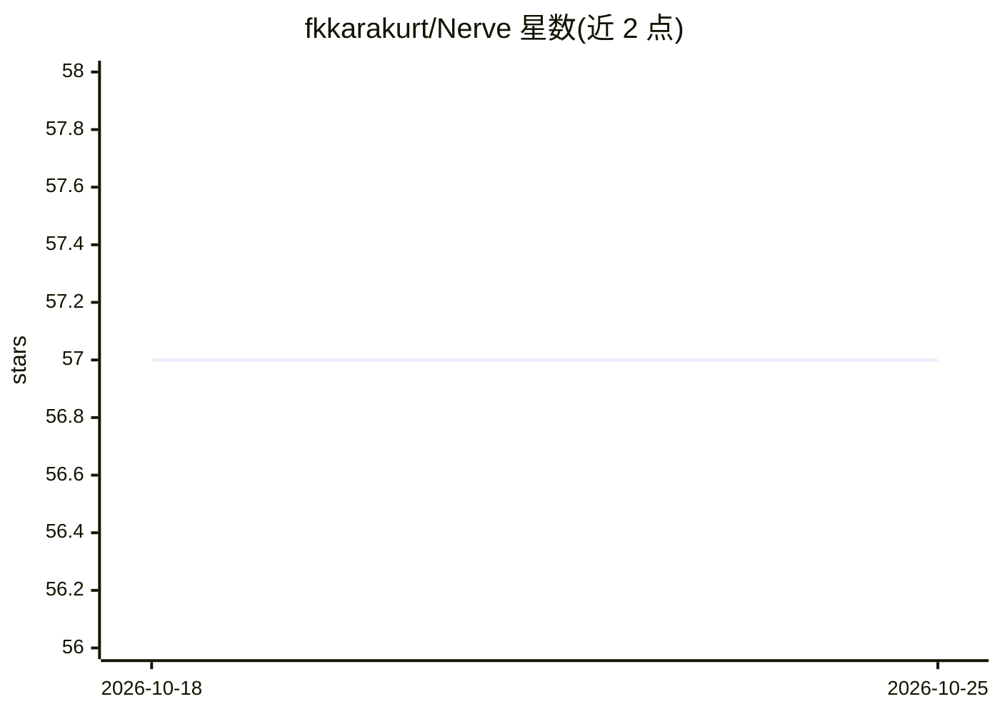

# fkkarakurt/Nerve

⭐ 57 · C · Apache-2.0 · 推送 2026-09-13 · [GitHub](https://github.com/fkkarakurt/Nerve) · [官网](https://fkkarakurt.github.io/Nerve/) · 个人维护

**零依赖单头文件的 C 语言机器学习库：符号回归、Transformer 推理与嵌入**

以单个 C99 头文件实现的机器学习库：包含 MLP 训练（Adam/Dropout/Xavier/He）、基于遗传规划的符号回归公式发现（Feynman 100 方程中恢复 82 个至 R²≥0.999）、1.1B 参数 decoder Transformer 推理（RMSNorm/RoPE/GQA/KV-cache/int8）、MiniLM 句子嵌入与 MNIST 手写识别。自带 xoshiro128** 随机数生成器保证跨平台确定性。可用 gcc 单命令编译，或经 WebAssembly 以 npm 包在浏览器/Node 运行，支持微控制器到浏览器等多种环境。

## 筛选速览

| 维度 | 判定 | 备注 |
|---|---|---|
| AI 角色 | `ai-native` | 本体是模型或模型工具 |
| 许可风险 | `permissive` | Apache-2.0 |
| 部署形态 | `library` | 以包/库形式分发 |
| 模型依赖 | — | README 未给出锁定关系 |
| 硬件要求 | — | 无带数字的原话,不猜 |
| 安装摩擦 | `medium` | 含编译或系统依赖之一 |
| 成熟度 | — | 结构信号不足 |

## 能力要点

- 符号回归从数据中恢复可读公式（Feynman 基准 82/100 达 R²≥0.999）
- 单头文件实现 1.1B 参数 Transformer 推理，TinyLlama 笔记本 CPU 约 3 tok/s
- 内置确定性随机数生成器与反向自动微分
- 可编译为 WebAssembly 在浏览器端运行，另有 npm 包

## 适用场景

- 在嵌入式设备或微控制器上运行神经网络训练与推理
- 从实验数据中拟合出可读的数学公式
- 在浏览器中本地运行文本生成、语义搜索与手写识别
- 阅读源码学习 Transformer、Adam、自动微分等算法实现

## 场景标签

`语义搜索` `推理引擎` · 领域:知识与检索

## 证据(README 行号)

> L50: |**Run a real 1.1B-parameter LLM**|decoder Transformer (RMSNorm, RoPE, GQA + KV-cache, SwiGLU, int8) in one header|
> L52: |**Understand meaning**|a MiniLM BERT-style sentence encoder (int8, ~22 MB)|`hamburger → food`, `running shoes → fi

## 星数曲线

2026-10-18 57 → 2026-10-25 57（+0）

---
*卡片 v1 · prompt 1.4 · 生成 2026-10-24 · 置信度 high · 依据 README sha `a8160be86488` · [字段定义](../../DATASET.md)*
