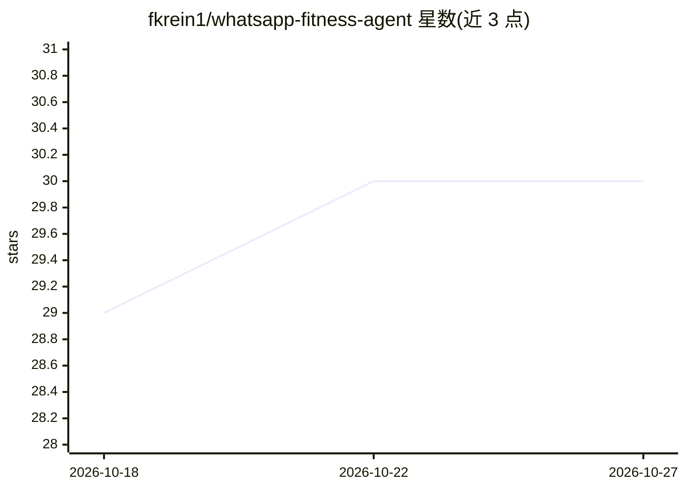

# fkrein1/whatsapp-fitness-agent

⭐ 30 · TypeScript · MIT · 推送 2026-09-28 · [GitHub](https://github.com/fkrein1/whatsapp-fitness-agent) · [官网](https://whatsapp-fitness-agent.fkrein.workers.dev) · 个人维护

**单用户 WhatsApp 健身记录 agent：聊天中记录训练/饮食/体重**

部署在 Cloudflare Workers 上的单用户健身日志 agent：通过 WhatsApp 接收力量训练、跑步、餐食照片、语音笔记与体重更新，由 GPT-6 Luna 抽取结构化数据存入 D1，并回答近期活动查询。机制包括 Brave Search 查询巴西食品营养来源、Cloudflare Whisper 语音转录、餐食草稿确认流程、运动动作目录与别名合并、软删除与审计轨迹。限制：仅一个白名单用户、Meta 测试号码、无面板与数据导出。需 Node.js/pnpm 与 Cloudflare/Meta 开发者账号部署。

## 筛选速览

| 维度 | 判定 | 备注 |
|---|---|---|
| AI 角色 | `ai-native` | 本体是模型或模型工具 |
| 许可风险 | `permissive` | MIT |
| 部署形态 | `library` | 以包/库形式分发 |
| 模型依赖 | — | README 未给出锁定关系 |
| 硬件要求 | — | 无带数字的原话,不猜 |
| 安装摩擦 | `low` | 无编译、无系统依赖或容器化 |
| 成熟度 | — | 结构信号不足 |

## 能力要点

- WhatsApp 消息抽取结构化健身数据（训练组次、跑步、餐食热量/宏量、体重）
- 持久化用户画像（Soul）Markdown 文档且每版可追溯
- Brave Search 优先官方来源查营养数据，模型估算为回退并记录来源
- Vitest 测试覆盖 webhook 验证、餐食草稿、软删除、审计等 16 类场景

## 适用场景

- 在 WhatsApp 对话里记录训练、跑步、餐食和体重
- 通过对话查询近期训练与饮食趋势
- 用语音笔记或餐食照片记录摄入并核对营养来源

## 场景标签

`聊天机器人` · 领域:对话与助手

## 证据(README 行号)

> L3: A single-user fitness log that lives in WhatsApp. Send a workout, run, meal photo, voice note, or body-weight update
> L51: Luna and Whisper run through the Worker's Cloudflare AI binding and AI Gateway with Unified Billing. No OpenAI API 
> L71: - GPT-6 Luna with vision and structured tool calls

## 星数曲线

2026-10-18 29 → 2026-10-27 30（+1）

---
*卡片 v1 · prompt 1.4 · 生成 2026-10-26 · 置信度 mid · 依据 README sha `6f2db5ec790b` · [字段定义](../../DATASET.md)*
