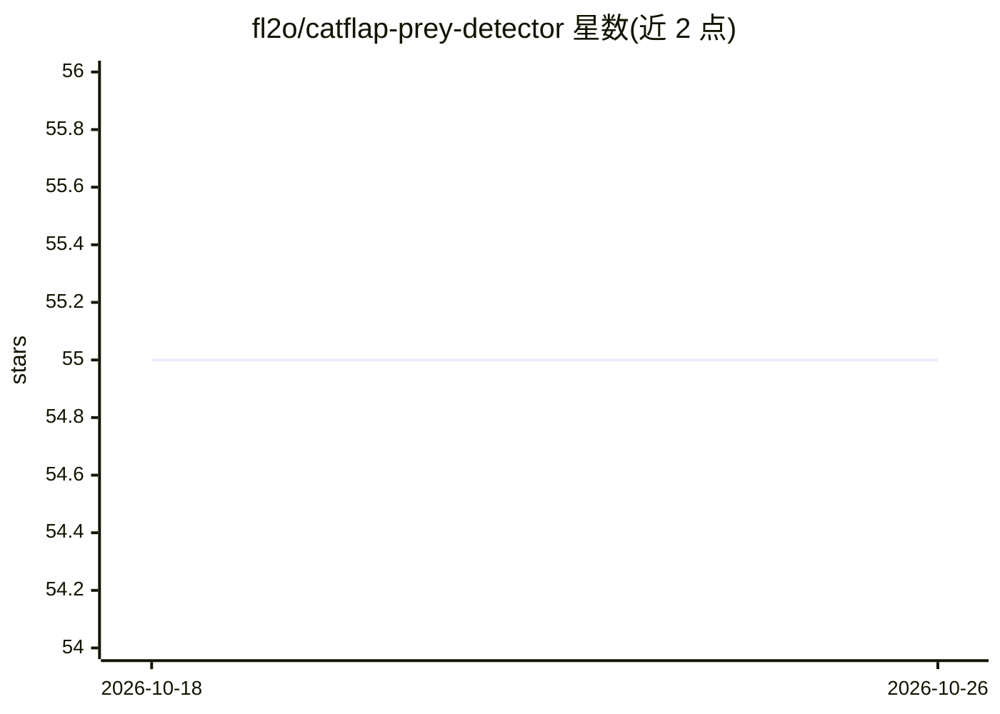

# fl2o/catflap-prey-detector

⭐ 55 · Python · Apache-2.0 · 推送 2026-05-30 · [GitHub](https://github.com/fl2o/catflap-prey-detector) · 个人维护

**树莓派猫门猎物检测系统：识别携猎物的猫并自动锁门**

运行于 Raspberry Pi 5 的 DIY 猫门控制系统：夜视摄像头采集画面，YOLO11n（NCNN）检测并跟踪猫、人等对象，再调用作者自建的 Prey Detection API 判断猫是否携带猎物，命中时通过 RFID 干扰器阻塞猫门，默认 5 分钟后自动解锁。支持 Telegram 机器人远程控制与带图通知，可选 Google Cloud Storage 图片持久化，可安装为 systemd 服务无人值守运行。依赖作者自建的付费 API（可替换为自训练模型），需组装指定硬件。

## 筛选速览

| 维度 | 判定 | 备注 |
|---|---|---|
| AI 角色 | `ai-native` | 本体是模型或模型工具 |
| 许可风险 | `permissive` | Apache-2.0 |
| 部署形态 | `None` |  |
| 模型依赖 | — | README 未给出锁定关系 |
| 硬件要求 | — | 无带数字的原话,不猜 |
| 安装摩擦 | `medium` | 含编译或系统依赖之一 |
| 成熟度 | — | 结构信号不足 |

## 能力要点

- YOLO11n（NCNN）+ 自建 Prey Detection API 两级检测
- RFID 干扰器自动锁门，默认 5 分钟后自动解锁
- Telegram 机器人远程控制（lock/unlock/status/photo/ping）与通知
- 可安装为 systemd 服务，带 watchdog 自恢复

## 适用场景

- 阻止猫把老鼠、鸟等猎物带进家门
- 通过 Telegram 远程查看猫门状态与实时画面
- 同时监控猫门前的人等对象并接收通知

## 场景标签

`目标检测` · 领域:感知与多模态

## 证据(README 行号)

> L52: - 🤖 AI-powered prey detection using YOLO11n and custom Prey Detection API
> L114: - **YOLO11n (NCNN)** - Fast object detection for tracking cats and other objects

## 星数曲线

2026-10-18 55 → 2026-10-26 55（+0）

---
*卡片 v1 · prompt 1.4 · 生成 2026-10-24 · 置信度 high · 依据 README sha `e2829f4e1221` · [字段定义](../../DATASET.md)*
