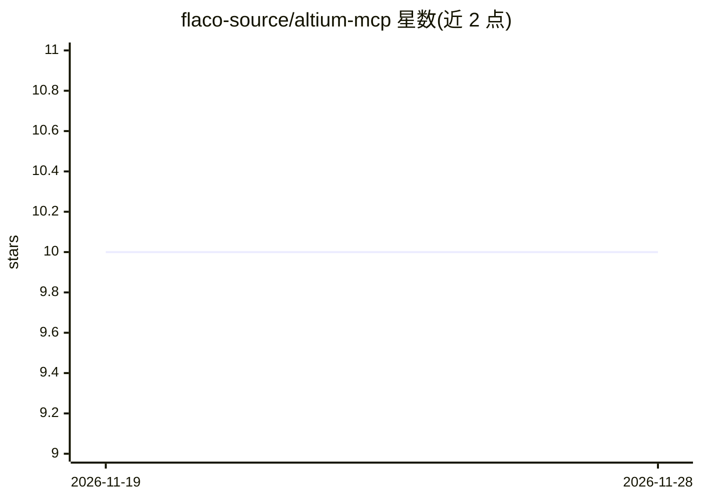

# flaco-source/altium-mcp

⭐ 10 · Pascal · MIT · 推送 2026-04-08 · [GitHub](https://github.com/flaco-source/altium-mcp) · 个人维护

**让 Cursor 通过 MCP 查询并操控 Altium Designer 的桥接服务器**

一个 MCP 服务器（Node.js/TypeScript，stdio 传输），将 Cursor 等 MCP 客户端连接到 Windows 上的 Altium Designer：通过写入 request.json 并以 DelphiScript 脚本（-RScriptingSystem:RunScript）驱动 Altium 执行 PCB/原理图 API 调用、写回 response.json，文件锁序列化并发调用。提供状态检查、ping、工程/原理图数据导出、原理图编辑（移动/旋转、放置元件、导线、总线等）与 PCB 查询等 MCP 工具。要求 Windows 10/11、Altium Designer 22+、Node.js 20+。第三方项目，非 Altium 官方。

## 筛选速览

| 维度 | 判定 | 备注 |
|---|---|---|
| AI 角色 | `ai-ecosystem` | LLM/agent 周边工具 |
| 许可风险 | `permissive` | MIT |
| 部署形态 | `desktop` | 安装包/桌面程序 |
| 模型依赖 | — | README 未给出锁定关系 |
| 硬件要求 | — | 无带数字的原话,不猜 |
| 安装摩擦 | `low` | 无编译、无系统依赖或容器化 |
| 成熟度 | — | 结构信号不足 |

## 能力要点

- DelphiScript 文件桥（request/response.json + .bridge.lock）实现 MCP 与 Altium 通信
- edit_schematic 支持编辑 .SchDoc：移动/旋转、放置元件、导线、总线、网络标签等
- get_schematic_data 支持可选 include_queries 过滤（wires/nets/components 等）
- 源自 coffeenmusic/altium-mcp 的 MIT 许可 DelphiScript，新增 schematic export/edit 等功能

## 适用场景

- 在 Cursor 中用自然语言查询打开的 PCB 网络、层、引脚信息
- 通过 AI 助手批量编辑原理图并回读校验
- 用 altium_ping/get_server_status 诊断 Altium 自动化桥接状态

## 场景标签

`AI 助手` · 领域:对话与助手

## 证据(README 行号)

> L3: **Model Context Protocol (MCP) server** that connects Cursor (and other MCP clients) to **Altium Designer** on **Win
> L38: - The server writes **`request.json`** under the workspace (default `%USERPROFILE%\.altium-mcp\workspace`).
> L40: - DelphiScript **`Run`** reads the request, runs PCB/SCH API calls, and writes **`response.json`**.

## 星数曲线

2026-11-19 10 → 2026-11-28 10（+0）

---
*卡片 v1 · prompt 1.4 · 生成 2026-11-19 · 置信度 high · 依据 README sha `39ca2f039db1` · [字段定义](../../DATASET.md)*
