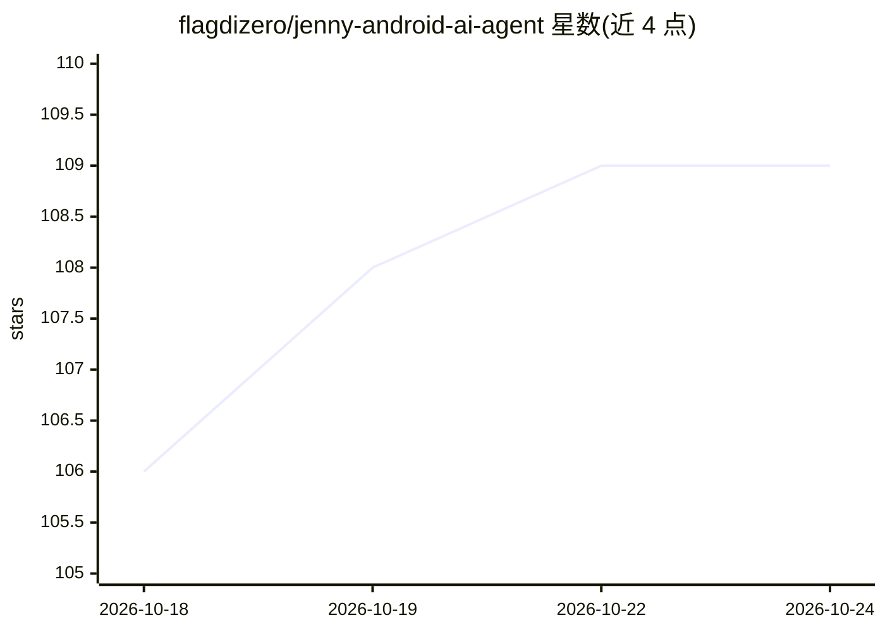

# flagdizero/jenny-android-ai-agent

⭐ 113 · Python · AGPL-3.0 · 推送 2026-10-04 · [GitHub](https://github.com/flagdizero/jenny-android-ai-agent) · [官网](https://jenny.flagdizero.com) · 个人维护

**运行在 Android 手机上的本地优先个人 AI agent 应用**

Android 应用（内嵌 CPython 3.11/Chaquopy），以持续前台服务运行一个个人 AI agent：提供设备端永久记忆（定期将对话提炼为 Markdown）、定时自主任务与提醒、按对话请求自写 Android 迷你应用（动作可作为工具被调用）、由聊天驱动的 wiki 构建功能，并可注册为主屏启动器。BYOK 支持 40+ 提供商，也可指向 Ollama/LM Studio 全程离线运行。数据存于设备私有存储，AGPL-3.0，个人开发者的 1.0 版本，仅侧载分发（无商店），已知限制（Bing-only 搜索、python_exec 非沙箱等）在 README 中逐条列出。

## 筛选速览

| 维度 | 判定 | 备注 |
|---|---|---|
| AI 角色 | `ai-native` | 本体是模型或模型工具 |
| 许可风险 | `viral` | AGPL-3.0 |
| 部署形态 | `desktop` | 安装包/桌面程序 |
| 模型依赖 | local-ok | 支持本地模型 |
| 硬件要求 | — | 无带数字的原话,不猜 |
| 安装摩擦 | `low` | 无编译、无系统依赖或容器化 |
| 成熟度 | `idea` | |

## 能力要点

- 设备端永久记忆：后台定期提炼对话为结构化 Markdown
- 按对话请求生成可被工具调用（含 cron）的 Android 迷你应用
- 支持 40+ BYOK 提供商，或经 Ollama/LM Studio 全程离线运行
- 可注册为 HOME 启动器，前台服务支持关屏后定时任务

## 适用场景

- 在手机上常驻一个带永久记忆的个人 AI 助手
- 让 agent 定时执行任务并在锁屏时主动提醒我
- 用自然语言让 agent 为我生成小工具应用
- 本地模型 + 自有硬件，实现完全离线的 agent 循环

## 场景标签

`AI 助手` · 领域:对话与助手

## 证据(README 行号)

> L5: It remembers you permanently, acts on a schedule without being asked, writes its own
> L27: Jenny is an Android app with an embedded Python runtime. It registers as a HOME activity, so

## 星数曲线

2026-10-18 106 → 2026-10-24 109（+3）

---
*卡片 v1 · prompt 1.4 · 生成 2026-10-23 · 置信度 high · 依据 README sha `e3a34ea1a86b` · [字段定义](../../DATASET.md)*
