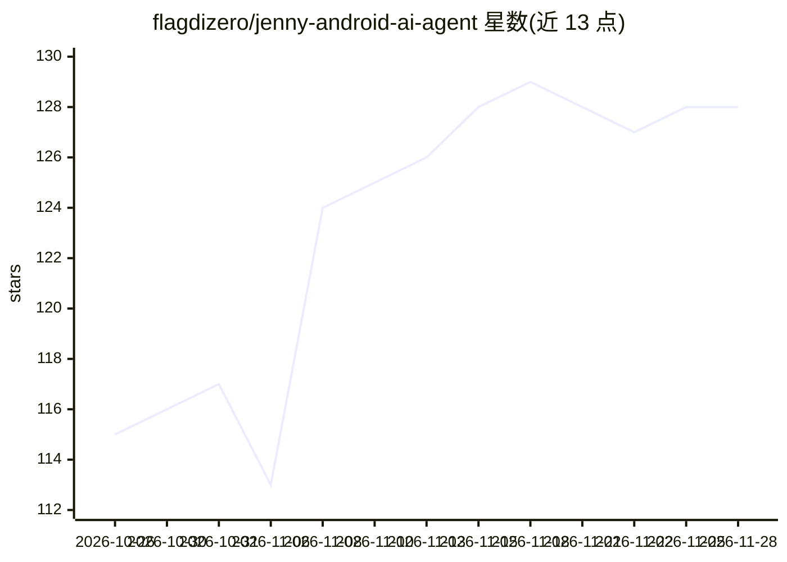

# flagdizero/jenny-android-ai-agent

⭐ 128 · Python · AGPL-3.0 · 推送 2026-11-27 · [GitHub](https://github.com/flagdizero/jenny-android-ai-agent) · [官网](https://jenny.flagdizero.com) · 个人维护

**本地优先的 Android 个人 AI agent：常驻手机、离线可用**

以 Android 应用形式提供的个人 AI agent，内嵌 CPython 3.11 运行时，以前台服务常驻运行。提供设备端持久记忆（对话蒸馏为结构化 Markdown）、定时自主任务与主动消息、自写 mini-app 并装入应用格、Markdown wiki 编译，并可注册为 HOME 活动充当启动器。数据留在设备，通过 BYOK 接入 40+ 提供商，或指向本地模型实现全离线。仅提供侧载 APK 或源码构建，AGPL-3.0，个人项目，无商店渠道与自动更新。

## 筛选速览

| 维度 | 判定 | 备注 |
|---|---|---|
| AI 角色 | `ai-native` | 本体是模型或模型工具 |
| 许可风险 | `viral` | AGPL-3.0 |
| 部署形态 | `desktop` | 安装包/桌面程序 |
| 模型依赖 | local-ok | 支持本地模型 |
| 硬件要求 | — | 无带数字的原话,不猜 |
| 安装摩擦 | `low` | 无编译、无系统依赖或容器化 |
| 成熟度 | — | 结构信号不足 |

## 能力要点

- 设备端持久记忆：后台将对话蒸馏为结构化 Markdown，存于本地
- 定时任务与主动消息，息屏时也可触发并先行发消息
- 按描述自写 Android mini-app，其操作可被 agent 通过 use_app 工具调用
- BYOK 支持 40+ 提供商，或接 Ollama/LM Studio 全离线运行

## 适用场景

- 在个人手机上运行不依赖云服务的 AI 助手
- 让 agent 按计划自动完成总结、提醒等周期性任务
- 用聊天描述并生成记录植物状态之类的小工具
- 把首页替换为对话式启动器

## 场景标签

`AI 助手` · 领域:对话与助手

## 证据(README 行号)

> L25: ## An AI agent that runs on your phone, not in someone's cloud
> L47: - **The model provider is your choice, and it is optional.** Point Jenny at Ollama or
> L57: **🧠 Permanent on-device memory.** Every couple of hours a background pass replays the recent

## 星数曲线

2026-10-26 115 → 2026-11-28 128（+13）

---
*卡片 v1 · prompt 1.4 · 生成 2026-11-28 · 置信度 high · 依据 README sha `95b85bc84d3c` · [字段定义](../../DATASET.md)*
