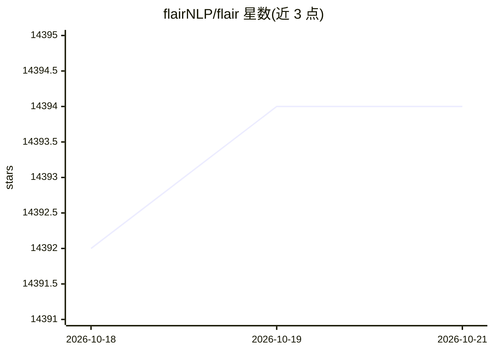

# flairNLP/flair

⭐ 14,394 · Python · NOASSERTION · 推送 2026-10-19 · [GitHub](https://github.com/flairNLP/flair) · [官网](https://flairnlp.github.io/flair/) · 组织维护

**面向开发者的 NLP 任务库：NER、情感分析、词性标注与文本嵌入**

由柏林洪堡大学等开发的 PyTorch NLP 框架，当前版本 0.15.1。提供预训练模型覆盖命名实体识别、情感分析、词性标注、 biomedical 文本处理、词义消歧与分类，支持多语言。同时作为文本嵌入库提供词与文档嵌入的组合接口，可直接基于 PyTorch 训练自定义模型。模型托管于 Hugging Face model hub，README 附带在线 demo 与评分对比表，需 Python 3.9+。

## 筛选速览

| 维度 | 判定 | 备注 |
|---|---|---|
| AI 角色 | `ai-ecosystem` | LLM/agent 周边工具 |
| 许可风险 | `permissive` | NOASSERTION |
| 部署形态 | `library` | 以包/库形式分发 |
| 模型依赖 | — | README 未给出锁定关系 |
| 硬件要求 | — | 无带数字的原话,不猜 |
| 安装摩擦 | `low` | 无编译、无系统依赖或容器化 |
| 成熟度 | — | 结构信号不足 |

## 动量与使用信号

- 维护:`declining` — 距上次 push 355.6 天,年发版 0,206 位贡献者
- 涨星:近 1 天 **-2**(自 20261016 起算)
- 安装:pypi 包 `flair` 月下载 58,345

## 能力要点

- 提供 NER、情感分析、词性标注等任务的预训练模型
- 支持组合多种词与文档嵌入（含 Flair embeddings 与 transformers）
- 构建于 PyTorch 之上，可训练自定义模型
- 模型托管在 Hugging Face model hub 并提供在线试用

## 适用场景

- 对文本做命名实体识别与实体抽取
- 判断句子或评论的情感倾向
- 为词和文档生成嵌入向量
- 处理生物医学文本的实体识别

## 场景标签

 · 领域:自然语言处理/机器学习框架

## 证据(README 行号)

> L9: A very simple framework for **state-of-the-art NLP**. Developed by Humboldt University of Berlin and friends.
> L21: * **A PyTorch NLP framework.** Our framework builds directly on PyTorch, making it easy to
> L51: Flair requires Python 3.9+.

## 星数曲线

2026-10-18 14,392 → 2026-10-21 14,394（+2）

---
*卡片 v1 · prompt 1.4 · 生成 2026-10-18 · 置信度 high · 依据 README sha `72c35e3399ba` · [字段定义](../../DATASET.md)*
