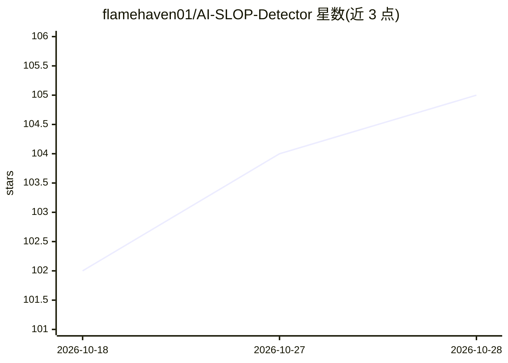

# flamehaven01/AI-SLOP-Detector

⭐ 105 · Python · MIT · 推送 2026-10-28 · [GitHub](https://github.com/flamehaven01/AI-SLOP-Detector) · [官网](https://flamehaven.space/work/ai-slop-detector/) · 个人维护

**面向开发者：静态检测 AI 生成代码中的空壳与造假结构**

证据驱动的静态分析器，针对 AI 辅助代码常见缺陷：空壳函数、无法解析的导入、不可达代码、跨文件复制粘贴、夸大性文档等 27 类检查，输出每文件 0-100 风险分数（加权几何均值）。默认评分路径完全离线、确定性、不调用 LLM，Python 优先，JS/TS 与 Go 为可选 extra。支持软/硬/隔离三级 CI 门禁、GitHub Actions、VS Code 扩展，并暴露 MCP stdio 接口供 agent 工具调用。限制：不检测代码是否由 AI 编写，不证明运行时正确性，不做风格检查。

## 筛选速览

| 维度 | 判定 | 备注 |
|---|---|---|
| AI 角色 | `ai-enhanced` | 去掉 AI 部分产品仍成立 |
| 许可风险 | `permissive` | MIT |
| 部署形态 | `library` | 以包/库形式分发 |
| 模型依赖 | — | README 未给出锁定关系 |
| 硬件要求 | — | 无带数字的原话,不猜 |
| 安装摩擦 | `low` | 无编译、无系统依赖或容器化 |
| 成熟度 | — | 结构信号不足 |

## 能力要点

- 27 类 fake-done 检查 + 每文件 0-100 风险分（加权几何均值）
- 默认路径离线确定性，无需 LLM、API key 或模型下载
- CI 三级门禁（soft/hard/quarantine）与 VS Code 扩展
- slop-detector mcp 提供 MCP stdio 接口供 agent 调用

## 适用场景

- 审阅 AI 辅助生成的代码是否结构完整而非表面完整
- 在 CI 中拦截空壳函数、幽灵导入等结构性缺陷
- 对 Python/JS/TS/Go 项目做结构风险评分与趋势跟踪

## 场景标签

 · 领域:开发者工具/代码质量

## 证据(README 行号)

> L17:  Runs fully offline &middot; deterministic core scoring &middot; no API key, no model download, nothing leaves your
> L53: AI-SLOP Detector is an **evidence-based static analyzer** that targets a defect class common in AI-assisted code: s
> L199: - The default scoring path is deterministic; it does not require an LLM or external API.

## 星数曲线

2026-10-18 102 → 2026-10-28 105（+3）

---
*卡片 v1 · prompt 1.4 · 生成 2026-10-23 · 置信度 mid · 依据 README sha `2788983098dd` · [字段定义](../../DATASET.md)*
