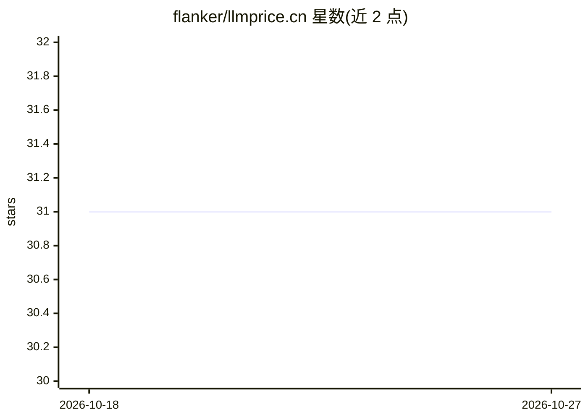

# flanker/llmprice.cn

⭐ 31 · HTML · 推送 2026-08-28 · [GitHub](https://github.com/flanker/llmprice.cn) · [官网](https://llmprice.cn/) · 个人维护 · 中文 README

**对比主流大模型 API 价格的静态网页（元/百万 Token）**

静态页面项目，在浏览器端读取 LiteLLM 模型价格数据（CDN 主源 + 双回退 + localStorage 兜底），按 provider 分组展示可定价文本模型，并按官方/直连、云平台、聚合/托管粗分筛选。价格字段由美元/token 统一换算为元/百万 Token，默认汇率 $1=¥7 可手动修改；阶梯价展示首档，0 值一律显示为「暂无」以区分免费与未收录。品牌图标由脚本生成，来自 Lobe Icons 与 Simple Icons。

## 筛选速览

| 维度 | 判定 | 备注 |
|---|---|---|
| AI 角色 | `ai-knowledge` | 知识聚合/清单类 |
| 许可风险 | `none` | — |
| 部署形态 | `None` |  |
| 模型依赖 | — | README 未给出锁定关系 |
| 硬件要求 | — | 无带数字的原话,不猜 |
| 安装摩擦 | `low` | 无编译、无系统依赖或容器化 |
| 成熟度 | — | 结构信号不足 |

## 能力要点

- 直接使用 LiteLLM 完整模型配置，浏览器端动态同步最新价格
- 按 provider 分组展示，支持官方/直连、云平台、聚合/托管筛选
- 美元/token 统一换算为元/百万 Token，汇率可手动输入
- 0 值价格统一显示「暂无」，区分免费与未收录

## 适用场景

- 查询和对比各家大模型的 API 价格
- 按厂商类型筛选可用的文本模型
- 国内用户以人民币视角查看模型定价

## 场景标签

 · 领域:LLM 信息聚合/工具

## 证据(README 行号)

> L5: 这是一个静态页面项目，用来对比主流文本模型的 API 价格。
> L11: 2. 再请求 LiteLLM 最新价格表

## 星数曲线

2026-10-18 31 → 2026-10-27 31（+0）

---
*卡片 v1 · prompt 1.4 · 生成 2026-10-26 · 置信度 mid · 依据 README sha `486582eb431d` · [字段定义](../../DATASET.md)*
