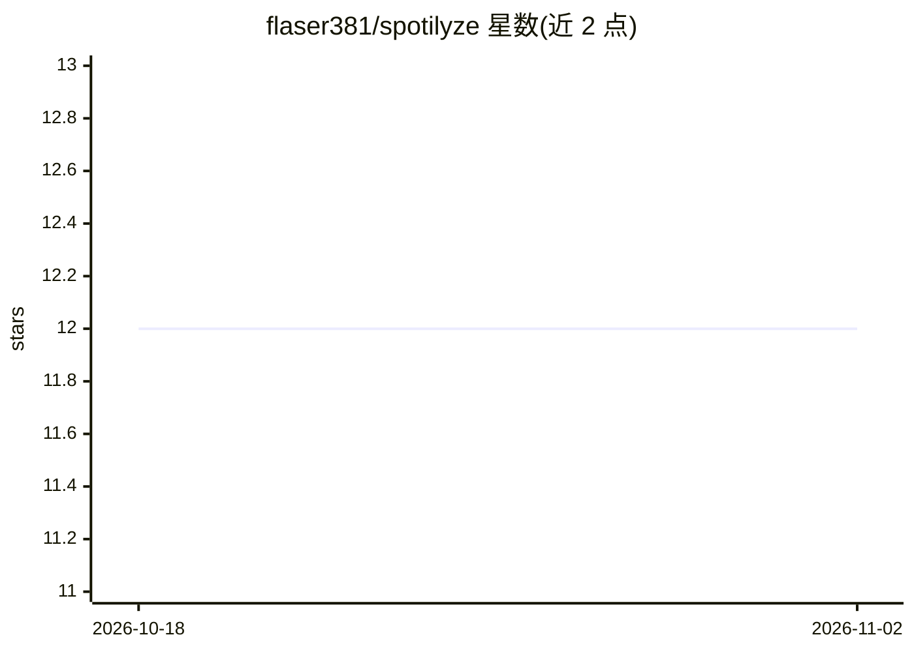

# flaser381/spotilyze

⭐ 12 · TypeScript · AGPL-3.0 · 推送 2026-06-29 · [GitHub](https://github.com/flaser381/spotilyze) · 个人维护

**本地分析 Spotify 收听史的工具：听味变化与可选 AI 解读**

读取 Spotify Extended Streaming History 导出数据，在用户本机运行：将每首歌映射到 Arousal·Valence·Depth 三维声音画像，通过滑动窗口变点检测找出收听口味转变的阶段，并呈现时段热图、口味稳定性、快跳/完整播放等指标及单文件 HTML 导出。AI 部分为可选项：接入本地模型或自有 API key 生成人格解读/吐槽/推荐等文本报告，跳过后其余功能仍可用。以 Docker 或 Bun 源码方式运行，README 声明其为 AI 辅助的业余项目、非经验证的科学研究工具。

## 筛选速览

| 维度 | 判定 | 备注 |
|---|---|---|
| AI 角色 | `ai-enhanced` | 去掉 AI 部分产品仍成立 |
| 许可风险 | `viral` | AGPL-3.0 |
| 部署形态 | `self-host` | docker 或自建部署 |
| 模型依赖 | local-ok | 支持本地模型 |
| 硬件要求 | — | 无带数字的原话,不猜 |
| 安装摩擦 | `low` | 无编译、无系统依赖或容器化 |
| 成熟度 | `idea` | |

## 能力要点

- AVD 声音画像（基于 1,837 流派的 genre×AVD 表）
- 滑动窗口变点检测收听阶段转变
- 可选 LLM 报告：分析者/广告画像/约会解读/吐槽/推荐多种人格
- 本地优先：数据在设备上处理，无账号无上传端点

## 适用场景

- 导入我的 Spotify 导出数据，查看口味随年份的漂移
- 用本地 Ollama 模型生成可选的收听人格解读
- 与朋友对比两人的收听历史

## 场景标签

`数据分析` · 领域:效率与自动化

## 证据(README 行号)

> L24: - **🧬 An optional AI write-up.** Point it at a local model or your own API key for a written personality read, or a
> L111: > AI features (the written personality read) are **optional**, skip them and everything else still works.

## 星数曲线

2026-10-18 12 → 2026-11-02 12（+0）

---
*卡片 v1 · prompt 1.4 · 生成 2026-11-01 · 置信度 high · 依据 README sha `3fb6446971a8` · [字段定义](../../DATASET.md)*
