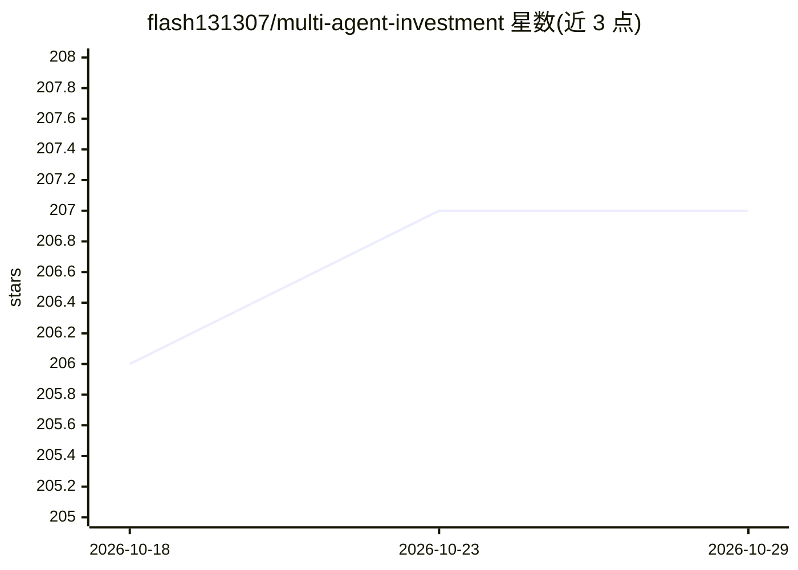

# flash131307/multi-agent-investment

⭐ 207 · Python · MIT · 推送 2026-03-26 · [GitHub](https://github.com/flash131307/multi-agent-investment) · 个人维护

**多智能体股票研究系统：三路 Agent 信号经确定性数学融合给出买卖决策**

面向量化/股票研究开发者的多智能体股权研究系统：三个独立 Agent（ReAct 技术分析、FinBERT 情感漏斗、Plan-and-Solve+RAG 基本面）并行执行，通过纯数学的 Decision Hub（一致性评分、动态加权、加权聚合）融合为 BUY/NEUTRAL/SELL 决策；LLM 仅在决策确定后生成解释文本，不参与决策本身。支持 1-2 个 Agent 失效时的降级运行，RAG 检索基于 SEC 10-K 文件。以 FastAPI 后端 + React 前端提供，需 OpenAI API 与 FinBERT 本地推理。

## 筛选速览

| 维度 | 判定 | 备注 |
|---|---|---|
| AI 角色 | `ai-native` | 本体是模型或模型工具 |
| 许可风险 | `permissive` | MIT |
| 部署形态 | `None` |  |
| 模型依赖 | — | README 未给出锁定关系 |
| 硬件要求 | — | 无带数字的原话,不猜 |
| 安装摩擦 | `low` | 无编译、无系统依赖或容器化 |
| 成熟度 | — | 结构信号不足 |

## 能力要点

- 决策由确定性数学 Decision Hub 生成，LLM 仅事后生成解释
- 三种推理模式：ReAct、FinBERT 情感漏斗（零 LLM）、Plan-and-Solve + 混合 RAG（dense+BM25+RRF）
- 降级运行：1-2 个 Agent 失效仍可产出决策并发出警告
- FinBERT 本地推理做金融情感分类，CPU 上约 0.3s 处理 25 篇文章

## 适用场景

- 输入股票代码获得可审计的 BUY/NEUTRAL/SELL 决策及解释
- 研究人员复现确定性、可解释的多 Agent 信号融合流程
- 在 1-2 个 Agent 失效时仍获取带置信度折扣的分析结果

## 场景标签

`多智能体` `金融量化` `RAG` · 领域:Agent 开发

## 证据(README 行号)

> L9: A multi-agent equity research system that produces **BUY / NEUTRAL / SELL** decisions by fusing three independent an
> L13: - **Deterministic decisions** — the Decision Hub is a pure mathematical function; same inputs always produce the sa

## 星数曲线

2026-10-18 206 → 2026-10-29 207（+1）

---
*卡片 v1 · prompt 1.4 · 生成 2026-10-22 · 置信度 high · 依据 README sha `90789b69f72d` · [字段定义](../../DATASET.md)*
