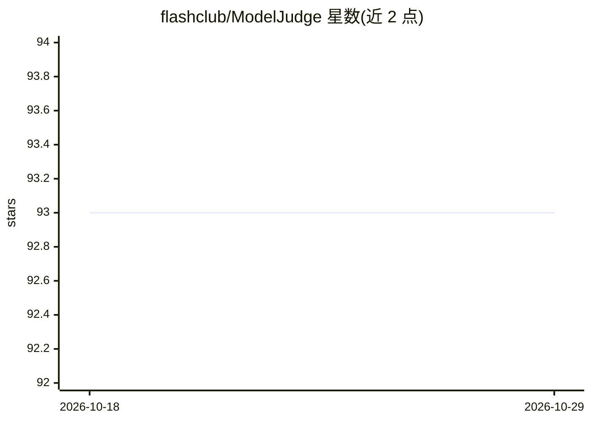

# flashclub/ModelJudge

⭐ 93 · TypeScript · MIT · 推送 2025-12-07 · [GitHub](https://github.com/flashclub/ModelJudge) · [官网](https://modeljudge.awesomeprompt.net/zh) · 个人维护 · 中文 README

**多模型回答对比与评分的 Next.js Web 平台**

基于 Next.js 的多语言 Web 应用：用户输入问题并选择三个模型，三个模型分别生成回答，再由第四个模型给出评分与最终回答，支持实时流式响应、中英文界面、响应式设计。模型调用依赖 SiliconCloud（SiliconFlow）API Key，Google/GitHub 登录与 Supabase 数据库为可选功能。项目抽离自 AwesomePrompt，通过 git clone + npm install 从源码运行，提供在线体验地址，采用 MIT 许可证。

## 筛选速览

| 维度 | 判定 | 备注 |
|---|---|---|
| AI 角色 | `ai-native` | 本体是模型或模型工具 |
| 许可风险 | `permissive` | MIT |
| 部署形态 | `library` | 以包/库形式分发 |
| 模型依赖 | — | README 未给出锁定关系 |
| 硬件要求 | — | 无带数字的原话,不猜 |
| 安装摩擦 | `low` | 无编译、无系统依赖或容器化 |
| 成熟度 | — | 结构信号不足 |

## 能力要点

- 三个模型生成回答、第四个模型评分并给出最终回答
- 实时流式响应与中英文国际化界面
- 支持 Google/GitHub 登录（可选）与 Supabase 后端（可选）

## 适用场景

- 向同一个问题对比多个模型的回答质量
- 让判别模型对多模型回答打分并汇总出最终回答
- 作为模型评估类 Web 应用的自部署底座

## 场景标签

`模型评测` · 领域:评测与运维

## 证据(README 行号)

> L7: 欢迎来到模型判官项目! 这是一个基于 Next.js 构建的 AI 模型评估平台。
> L8: 输入问题选择三个模型，生成回答，由第四个模型给出评分和最终回答! 🚀

## 星数曲线

2026-10-18 93 → 2026-10-29 93（+0）

---
*卡片 v1 · prompt 1.4 · 生成 2026-10-23 · 置信度 high · 依据 README sha `e0aa016f81c1` · [字段定义](../../DATASET.md)*
