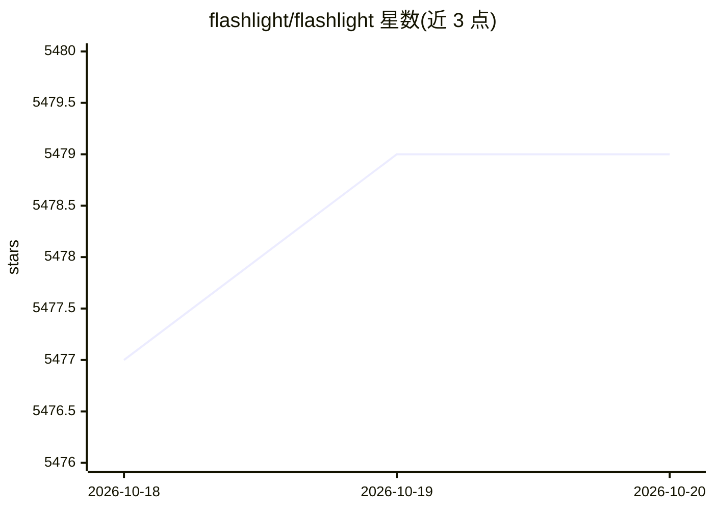

# flashlight/flashlight

⭐ 5,479 · C++ · MIT · 推送 2026-10-07 · [GitHub](https://github.com/flashlight/flashlight) · [官网](https://fl.readthedocs.io/en/latest/) · 组织维护

**纯 C++ 机器学习库，供研究者构建与训练神经网络**

由 Facebook AI Research 相关人员开发的 C++ 机器学习库，核心为基于 ArrayFire 张量后端的张量接口与神经网络库，核心部分体积在 10 MB、约 2 万行 C++ 以内，提供 tape 式自动微分。仓库分层为 lib（音频处理等独立工具）、fl（核心）、pkg（语音/视觉/文本领域包）与 app（ASR、图像分类、目标检测、语言建模应用）。通过 vcpkg、Docker 或源码（CMake）构建安装，支持 CUDA 与 CPU 两种后端，最低要求支持 C++17 的编译器、CMake 3.10+ 与 Linux 系统；CUDA 后端另需 CUDA>=9.2、cuDNN、NCCL 与 Intel MKL。

## 筛选速览

| 维度 | 判定 | 备注 |
|---|---|---|
| AI 角色 | `ai-native` | 本体是模型或模型工具 |
| 许可风险 | `permissive` | MIT |
| 部署形态 | `self-host` | docker 或自建部署 |
| 模型依赖 | — | README 未给出锁定关系 |
| 硬件要求 | — | 无带数字的原话,不猜 |
| 安装摩擦 | `low` | 无编译、无系统依赖或容器化 |
| 成熟度 | — | 结构信号不足 |

## 能力要点

- 基于 ArrayFire 的张量计算与 JIT 内核编译
- tape 式自动微分（Variable 抽象）
- 分层结构：核心库 + 语音/视觉/文本领域包 + ASR/图像分类/语言建模应用
- CUDA 与 CPU 双后端，可经 vcpkg 按特性安装

## 适用场景

- 用 C++ 从零实现并训练自定义神经网络实验
- 构建语音识别、图像分类或语言建模研究应用
- 作为可链接的张量/神经网络库嵌入自有 C++ 工程

## 场景标签

`模型训练` · 领域:训练与推理

## 证据(README 行号)

> L14: Flashlight is a fast, flexible machine learning library written entirely in C++
> L23: Native support in C++ and simple extensibility makes Flashlight a powerful research framework that enables fast ite
> L33: - **`flashlight/fl`** is the core tensor interface and neural network library using the ArrayFire tensor library by

## 星数曲线

2026-10-18 5,477 → 2026-10-20 5,479（+2）

---
*卡片 v1 · prompt 1.4 · 生成 2026-10-20 · 置信度 high · 依据 README sha `773172e73c24` · [字段定义](../../DATASET.md)*
