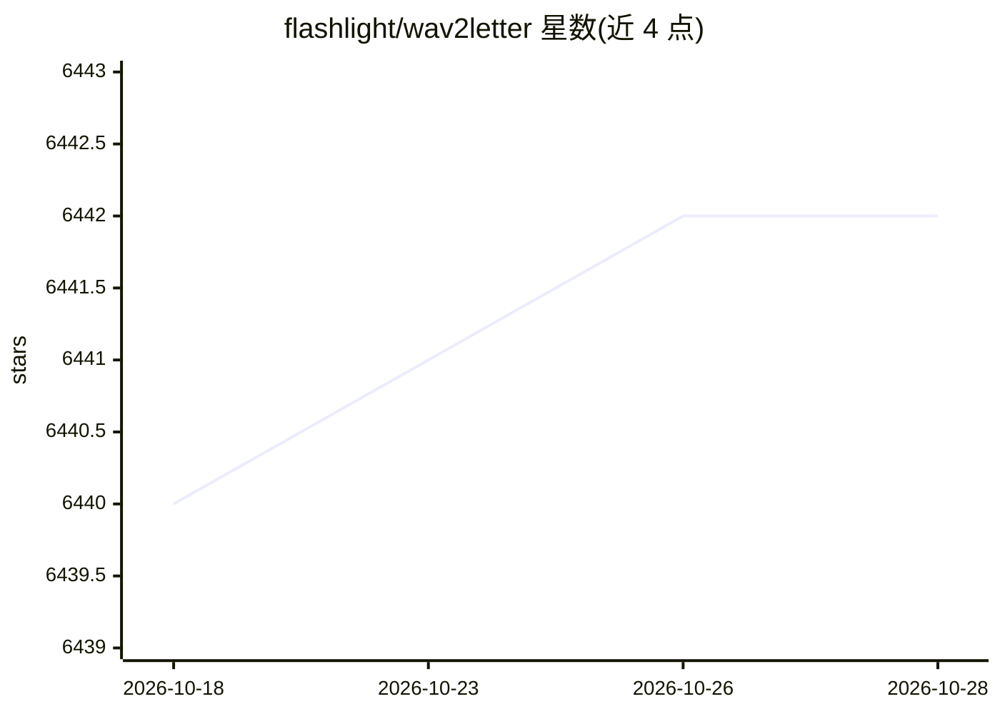

# flashlight/wav2letter

⭐ 6,442 · C++ · NOASSERTION · 推送 2026-08-28 · [GitHub](https://github.com/flashlight/wav2letter) · [官网](https://github.com/facebookresearch/wav2letter/wiki) · 组织维护

**Facebook AI 的端到端语音识别工具包，已并入 Flashlight**

Facebook AI Research 的自动语音识别（ASR）工具包 wav2letter++。README 声明项目已迁移并整合为 Flashlight 的 ASR 应用，后续开发在 Flashlight 中进行；本仓库现主要提供复现多篇研究论文（ConvNet 在线 ASR、半监督学习、自训练、免词典识别、时深可分卷积 Seq2Seq 等）的 recipes 与预训练模型，结果复现需使用 Flashlight <= 0.3.2。构建需先安装 Flashlight 0.3 分支及 ASR 应用，经 CMake 编译；MIT 许可。

## 筛选速览

| 维度 | 判定 | 备注 |
|---|---|---|
| AI 角色 | `ai-native` | 本体是模型或模型工具 |
| 许可风险 | `none` | NOASSERTION |
| 部署形态 | `None` |  |
| 模型依赖 | — | README 未给出锁定关系 |
| 硬件要求 | — | 无带数字的原话,不猜 |
| 安装摩擦 | `medium` | 含编译或系统依赖之一 |
| 成熟度 | — | 结构信号不足 |

## 能力要点

- 提供复现多篇 ASR 论文的 recipes 与预训练模型
- 支持免词典、半监督、自训练等端到端语音识别研究路线
- 旧版 wav2letter v0.2 与 wav2letter-lua 仍可检出构建

## 适用场景

- 复现语音识别研究论文的实验结果
- 获取端到端 ASR 预训练模型与数据准备流程
- 基于 Flashlight 进行 ASR 研究开发

## 场景标签

`语音识别` `科研工具` · 领域:学习与行业

## 证据(README 行号)

> L7: ### wav2letter has been moved and consolidated into Flashlight in the ASR application.
> L16: This repository includes recipes to reproduce the following research papers as well as *pre-trained* models. **All 

## 星数曲线

2026-10-18 6,440 → 2026-10-28 6,442（+2）

---
*卡片 v1 · prompt 1.4 · 生成 2026-10-20 · 置信度 high · 依据 README sha `bf9fd2f65313` · [字段定义](../../DATASET.md)*
