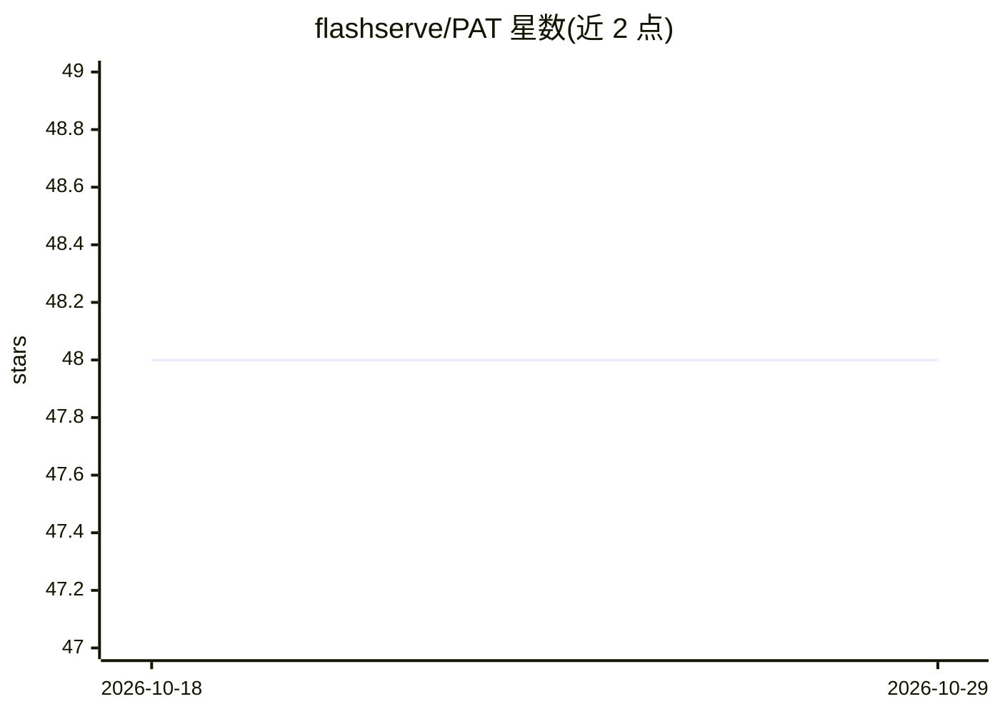

# flashserve/PAT

⭐ 48 · Python · MIT · 推送 2026-05-26 · [GitHub](https://github.com/flashserve/PAT) · [官网](https://dl.acm.org/doi/10.1145/3779212.3790200) · 组织维护

**面向 vLLM 的前缀感知解码注意力内核插件，减少 KV cache 读取**

PAT 是基于 CUTLASS 的高性能注意力内核实现，用于优化 transformer 模型解码阶段的注意力计算：识别批内序列的共享前缀模式，将共享前缀调度到独立 CTA 计算，从而减少 LLM 解码中 KV cache 的读取。以 vLLM 插件形式提供，通过环境变量 VLLM_ATTENTION_BACKEND="PREFIX_ATTN" 启用。支持 A100/H100 GPU（CUDA>=12.4），可用 Docker 镜像或从源码构建，源码构建需 1-3 小时。随附论文（ASPLOS 2026）实验复现脚本与基准测试。

## 筛选速览

| 维度 | 判定 | 备注 |
|---|---|---|
| AI 角色 | `ai-ecosystem` | LLM/agent 周边工具 |
| 许可风险 | `permissive` | MIT |
| 部署形态 | `self-host` | docker 或自建部署 |
| 模型依赖 | local-ok | 支持本地模型 |
| 硬件要求 | — | 无带数字的原话,不猜 |
| 安装摩擦 | `low` | 无编译、无系统依赖或容器化 |
| 成熟度 | — | 结构信号不足 |

## 能力要点

- 基于 CUTLASS 的多 tile 注意力内核，识别并分离批内共享前缀计算
- 以 vLLM 插件形式集成，一个环境变量即可启用
- 支持 NVIDIA A100 / H100（CUDA>=12.4），提供 Docker 与源码两种安装路径
- 附论文实验（内核基准与端到端服务基准）复现脚本

## 适用场景

- 在 vLLM 服务中加速含大量共享前缀的 LLM 解码负载
- 复现 ASPLOS 2026 论文的内核与端到端性能实验
- 研究批内共享前缀模式下的注意力计算优化

## 场景标签

`推理引擎` · 领域:训练与推理

## 证据(README 行号)

> L12: This repository provides **PAT** (Prefix-Aware Attention), a high-performance CUTLASS-based implementation designed
> L20: **Usage**: PAT serves as a plugin for LLM serving systems. To enble PAT in vLLM, only an environment variable `VLLM

## 星数曲线

2026-10-18 48 → 2026-10-29 48（+0）

---
*卡片 v1 · prompt 1.4 · 生成 2026-10-25 · 置信度 high · 依据 README sha `dcd0e1e27f5c` · [字段定义](../../DATASET.md)*
