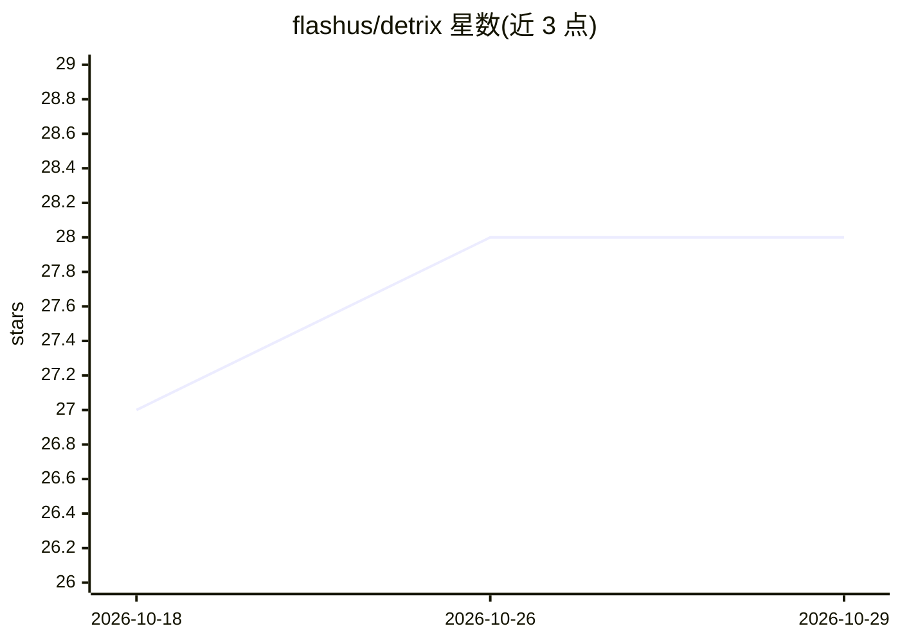

# flashus/detrix

⭐ 28 · Rust · MIT · 推送 2026-08-24 · [GitHub](https://github.com/flashus/detrix) · 个人维护

**让 AI agent 观察运行中代码的调试守护进程（MCP+DAP）**

本地或云端运行的守护进程，通过 Debug Adapter Protocol 连接应用的调试器（debugpy/delve/lldb-dap），以 29 个 MCP 工具让 AI agent 在不重启、不暂停、不改代码的情况下于任意行设置观察点、捕获变量值、查询事件与运行时内省。支持 Python/Go/Rust，可观察 Docker 容器与远程主机，事件存于 SQLite，提供 MCP/gRPC/REST/WebSocket 四种协议、敏感变量拦截与 JWT 认证。Rust/Go 需保留 DWARF 调试符号方可观察。

## 筛选速览

| 维度 | 判定 | 备注 |
|---|---|---|
| AI 角色 | `ai-ecosystem` | LLM/agent 周边工具 |
| 许可风险 | `permissive` | MIT |
| 部署形态 | `self-host` | docker 或自建部署 |
| 模型依赖 | — | README 未给出锁定关系 |
| 硬件要求 | — | 无带数字的原话,不猜 |
| 安装摩擦 | `low` | 无编译、无系统依赖或容器化 |
| 成熟度 | — | 结构信号不足 |

## 能力要点

- 29 个 MCP 工具：设观察点、查询事件、采样/节流等捕获模式
- 经 DAP 连接 debugpy/delve/lldb-dap，应用全速运行不暂停
- 敏感变量名默认拦截，detrix.toml 可配置黑白名单与 safe mode
- 事件持久化于 SQLite，支持 Docker/远程主机观察与 JWT/JWKS 认证

## 适用场景

- 让 Claude Code/Cursor 等 agent 在生产或 Docker 服务中实时定位 bug
- 免改代码、免重启地为运行中程序添加变量观察
- 隔夜排查：事件落盘后次日连接 agent 询问夜间发生的情况

## 场景标签

 · 领域:开发工具/调试与可观测性

## 证据(README 行号)

> L251: |**Agent tools**|29 MCP tools — observe any line, query events, enable/disable observation groups, and clean up; n

## 星数曲线

2026-10-18 27 → 2026-10-29 28（+1）

---
*卡片 v1 · prompt 1.4 · 生成 2026-10-26 · 置信度 mid · 依据 README sha `2255bab347aa` · [字段定义](../../DATASET.md)*
