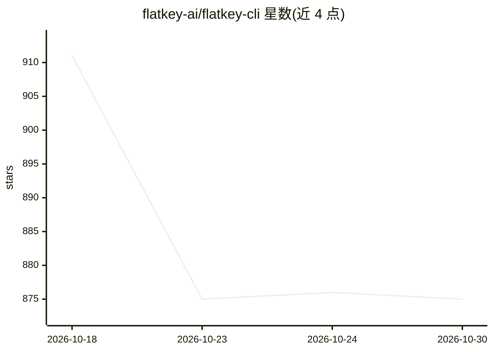

# flatkey-ai/flatkey-cli

⭐ 875 · JavaScript · MIT · 推送 2026-10-27 · [GitHub](https://github.com/flatkey-ai/flatkey-cli) · [官网](https://flatkey.ai/?utm_source=github&utm_medium=repo_homepage&utm_campaign=flatkey_cli) · 组织维护

**面向媒体团队与 AI agent 的多模态生成 CLI**

通过单一 FLATKEY_API_KEY 与 Flatkey 路由，在终端生成图片、视频（含语音、音效、音乐）与文本，并统一计费与模型发现。命令覆盖 image/video/audio/text generate、首尾帧与参考图输入、Depth Anything V2 视频复刻、dry-run 预检、JSON 输出与本地文件保存；README 含与 Higgsfield、Dreamina/Jimeng 的对比表。需登录 Flatkey 账户获得 API key，生成经云端路由完成。

## 筛选速览

| 维度 | 判定 | 备注 |
|---|---|---|
| AI 角色 | `ai-native` | 本体是模型或模型工具 |
| 许可风险 | `permissive` | MIT |
| 部署形态 | `library` | 以包/库形式分发 |
| 模型依赖 | — | README 未给出锁定关系 |
| 硬件要求 | — | 无带数字的原话,不猜 |
| 安装摩擦 | `low` | 无编译、无系统依赖或容器化 |
| 成熟度 | — | 结构信号不足 |

## 能力要点

- 一条 API key 路由 image/video/audio/text 多模态生成
- agent 友好的 --json 模式、--dry-run 与可预测 stdout/stderr
- 支持参考图/视频、首尾帧输入及 Depth Anything V2 视频复刻
- credits/status/models 命令查询余额、状态与模型注册表

## 适用场景

- 用脚本或 AI agent 批量生成图片、视频与音频素材
- 在终端做 prompt 迭代测试并用 --dry-run 预检请求
- 为重复性生成任务统一管理模型选择与费用查询

## 场景标签

`图像生成` `视频生成` · 领域:内容生成

## 证据(README 行号)

> L8: Creative generation from the terminal for media teams and AI agents. Generate images, videos, audio, and text throug
> L116: flatkey image generate \
> L269: `models` reads from the Flatkey console model registry. Generation calls use the Flatkey router.

## 星数曲线

2026-10-18 911 → 2026-10-30 875（-36）

---
*卡片 v1 · prompt 1.4 · 生成 2026-10-21 · 置信度 high · 依据 README sha `fcb0657671ad` · [字段定义](../../DATASET.md)*
